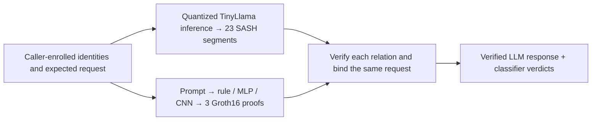

# Hallmark

**Cryptographic proofs of LLM inference and exact classifier decisions.**

[](https://github.com/AbdelStark/hallmark/actions/workflows/check.yml)
[](LICENSE.md)

[Quickstart](#quickstart) · [Benchmarks](#recorded-results-at-a-glance) · [What is proved?](#what-exactly-is-proved) · [Architecture](docs/ARCHITECTURE.md) · [Documentation](docs/README.md)

Hallmark proves a complete short response from a pinned, quantized
**TinyLlama-1.1B** using **SASH Circle STARKs**, and proves rule, MLP and CNN
classifier decisions using dedicated **gnark/Groth16** circuits. A composed demo
binds both to the same caller-owned request.

**53.94 s GPU proving · 10.15× over matched CPU · 23 verified segments through EOS.**

This is a working, fixed-case **research integrity MVP**. It uses specialized
inference proofs, with no general-purpose zkVM or hardware attestation.
Witness hiding, arbitrary prompts/models and production qualification are outside
the current scope. See [acceptance and limits](docs/MVP.md).

## Recorded results at a glance

### TinyLlama on H200: matched CPU / GPU

One CPU-then-CUDA pair on the **same H200 host**, using the same inputs, proof
parameters and four Rayon threads, recorded on 2026-10-26:

| Measurement | CPU / SIMD | GPU / CUDA | Observed speedup |
|---|---:|---:|---:|
| **Summed proving stages**, all 23 segments | 547.75 s | **53.94 s** | **10.15×** |
| **Complete segment commands** | 679.49 s | **155.89 s** | **4.36×** |
| Sampled peak host RSS, decimal GB | 103.75 GB | **8.07 GB** | — |
| Sampled peak GPU memory | — | **67.67 GiB** | — |

The CUDA build installs **77 generated constraint-kernel shapes** and records
**1,710 GPU constraint evaluations with zero CPU fallback**. Witness and
interaction generation remain on CPU. All **69 proof/statement/claim files
match byte for byte**, and all segment, residual and generated-token links pass.

| Proof and verification | Recorded result | Measurement boundary |
|---|---:|---|
| Proved response | **1.1B parameters · 8 tokens including EOS** | 22 transformer layers plus final normalization/output head; disclosed mixed quantization |
| Serialized proofs | **738 MB** | 737,858,641 bytes across 23 proof files; excludes statements, claims and weights |
| Native Mac verification | **3.40–3.53 s** | Per honest check after compilation on M4 Max; compiled caller-enrolled shape roots |
| Fresh Linux CPU verification | **77.40–77.61 s** | Per honest check on an 8-vCPU / 32-GB worker; derives shape roots at runtime |
| Complete GPU benchmark workflow | **34 min 47 s** | Reused preparation/build; both backends, grid checks, transfers and CPU/Mac verification |
| Classifier proof size | **292 bytes/proof** | Groth16 proof bytes only; excludes keys, enrollment and other evidence |

Fresh CPU verification accepts two honest checks and rejects **14 mutations**;
native Mac verification accepts two and rejects **36**. These share SASH's
cryptographic implementation; they are not independently developed verifiers.
Their preprocessing differs, so the Mac/Linux times are not a matched speedup.

The GPU result is **one fixed-case observation**, with shared OS caches and a
fixture-warmed driver, not a latency distribution. The 53.94 s figure excludes
preparation, compilation, transfers and verification. The 155.89 s figure covers
complete segment commands. The successful cached-build workflow has a **$1.76
running-compute estimate**, not an invoice; the original build, failed telemetry
attempt and successful rerun total **$3.37** by that measure.

[Reproduce the GPU benchmark](docs/GPU-BENCHMARK.md#run-it) ·
[Inspect raw numbers and hashes](research/evidence/llm-gpu-generated-constraints-2026-10-26.json) ·
[Retained slower fallback baseline](docs/GPU-BENCHMARK.md#recorded-same-host-result)

The separate [fresh CPU-only LLM workflow](docs/LLM-PROOF.md#measured-results)
took **31 min 15 s**, including preparation and build, with **5 min 28 s** summed
proving on a different 32-vCPU / 256-GB host. It is not the reference for the
GPU speedup. The [fresh composed workflow](docs/COMPOSED-DEMO.md#recorded-fresh-preparation)
took **66 min 50 s**. Classifiers are a separate, much smaller workload; no matched
Groth16/Circle STARK classifier benchmark exists yet.

## What exactly is proved?

The current LLM case is:

```text
Prompt:   Name the capital of France in one short sentence.
Response: The capital of France is Paris.
```

| Path | Cryptographic statement | Caller responsibilities |
|---|---|---|
| **LLM — SASH Circle STARK** | The enrolled quantized model computes the complete greedy answer through EOS: embedding, every transformer layer, final normalization and output argmax, with all segment/token links checked | Enroll expected model, shape and calibration roots and the exact token case; check pinned tokenization/detokenization outside the circuit |
| **Classifiers — gnark/Groth16 on BLS12-381** | A fixed integer rule, MLP or CNN computes its stated verdict on the complete admitted prompt bytes, including input hashing, arithmetic and threshold comparison | Reconstruct public inputs from the expected request; check circuit/key/model/context binding |
| **Composition — host verification** | Both verified relations refer to the same opened request | Check the common prompt/response context and combine verified classifier verdicts with `all-pass` |

A valid proof can establish a **block** verdict. Proof validity is separate from
classifier approval. Composed classifiers inspect the **prompt**; the response
is bound into their context, not classified. Training history is not proved.
The classifier caller currently reruns native inference to derive expected
verdicts, so this demo does not establish a verification saving over native rerun.

The LLM uses disclosed mixed quantization, `y-attnout-w12`; it is not a proof
of equivalence to the original floating-point model. The 23 segments form a linked
bundle, not a single recursive proof. Composition also joins proofs in host code.

**[LLM proof statement](docs/LLM-PROOF.md#the-statement)** ·
**[Classifier public inputs and trust boundary](docs/PROOFS.md)** ·
**[Composition and exact join](docs/COMPOSED-DEMO.md)**

## Architecture



The standalone classifier workflow uses authored response text and proves no LLM
generation. The composed workflow first runs nine classifier control proofs,
then creates three proofs for the proved LLM request.

SASH is fetched as **hash-pinned upstream source** and invoked through CLI adapters,
rather than installed as a Python dependency or copied wholesale into this repo.
The CPU prover uses unchanged upstream Rust. The CUDA build adds generated
constraint kernels and a strict fallback guard; witness preparation and the
optional native Mac verifier have separate explicit patches.
See [source ownership and patches](docs/ARCHITECTURE.md#how-sash-is-integrated)
and [the GPU build](docs/GPU-BENCHMARK.md).

## Quickstart

Clone the source checkout; packages and model checkpoints are not published:

```sh
git clone https://github.com/AbdelStark/hallmark.git
cd hallmark
```

### Train, prove and verify classifiers locally

Use an **Apple Silicon Mac**, Git, Make, curl and **uv 0.9.18**, with at least
**12 GiB free storage**. No GPU, token, cloud account or pretrained weights are needed.

```sh
make e2e
```

One command prepares pinned Python/Go environments, trains the MLP and byte CNN,
exports integer graphs, generates **nine real proofs** for three requests, and
checks them with the separate **py-ecc pairing verifier**. It also checks
18 cross-request substitutions and 405 arithmetic cases.

Expect the benign case to pass, the contextual case to be blocked by the CNN,
and the marker case to be blocked by the rule. Each invocation prints a fresh
`runs/` result path; failures return nonzero and preserve logs. Allow roughly
**20 minutes plus dependency/build time** on the recorded M4 Max.
[Prerequisites, outputs and troubleshooting](docs/DEMO.md).

### Prove the complete pretrained LLM response

Use an **Apple Silicon Mac**, Git, Make, uv 0.9.18, **32 GB RAM**,
**16 GiB free storage**, and an HF account with Jobs access and prepaid credits.
Set `HF_TOKEN` in the environment or ignored `.env` file and check available credits:

```sh
make e2e-llm
```

This downloads the pinned 2.2-GB Apache-2.0 TinyLlama checkpoint, prepares the
quantized response/witnesses locally, then starts **three sequential paid HF CPU
jobs** to build, prove and verify, under a **$2.10 timeout-based cost ceiling**.
No local GPU is needed. Success includes two honest verifications and 14 rejected
mutations. [LLM run guide](docs/LLM-PROOF.md#run-it).

To verify retained proofs locally, use the printed run directory:

```sh
# Requires an existing Rust installation; one-time toolchain setup:
rustup toolchain install nightly-2025-07-14 --profile minimal
make verify-llm LLM_RUN=runs/llm-e2e-...
```

Native verification needs **8 GiB free storage** and no weights or HF credentials.
Builds may download locked dependencies; verification itself is offline.
Read [shape enrollment and its trust boundary](docs/LLM-PROOF.md#verify-retained-proofs-on-your-mac),
including optional signed parameters.

### Reproduce the H200 GPU measurement

With the same Mac/Rust prerequisites, **16 GiB free storage**, HF credits and a
completed, caller-owned LLM run, check the live prepaid balance and pass it explicitly:

```sh
make benchmark-llm-gpu \
  LLM_RUN=/path/to/completed/llm-e2e-run \
  GPU_CREDIT_BALANCE_USD=YOUR_CHECKED_BALANCE
```

This starts **paid HF CPU/H200 jobs under a $5 single-run ceiling**. It reuses
frozen public witnesses, builds generated CUDA kernels, compares SIMD/CUDA on
one H200, and verifies GPU proofs in fresh CPU/Mac processes.
`GPU_BUILD_RUN=/path/to/llm-gpu-run` can reuse a matching caller-owned build.
[Run plan, costs, cache admission and failures](docs/GPU-BENCHMARK.md).

### Bind LLM generation and classifier proofs

```sh
make e2e-composed
```

This runs both workflows and binds three new classifier proofs to the proved
LLM request. It needs their combined prerequisites and **32 GiB free storage**.
Without retained inputs it starts the paid LLM jobs. Pass
`LLM_RUN=… CLASSIFIER_RUN=…` to reuse caller-owned runs without new cloud jobs;
LLM proofs are freshly verified and classifier keys/proofs are always new.
[Composition walkthrough and signed enrollment](docs/COMPOSED-DEMO.md).

### Smaller software check on Linux or macOS

```sh
uv sync --locked --python 3.12
uv run --locked hallmark validate-data fixtures/smoke.jsonl
make check-conformance
```

Expect a dataset summary, then **156 matched software cases** and **32 unavailable
full-evidence obligations**. This checks software contracts and generates no proof.
Core CI also covers CPython 3.13 and 3.14.

## Limits and research status

- **Fixed inference case.** The complete short TinyLlama response is verified;
  arbitrary prompts/models are not supported by this pipeline.
- **Public-witness integrity.** No witness-hiding or hardware-provenance claim.
  Caller enrollment is a trust boundary; a prover cannot authenticate its own parameters.
- **Synthetic classifiers.** Inputs are limited to **96 UTF-8 bytes** and oversized
  prompts reject. Synthetic accuracy does not establish a useful safety policy.
  The frozen CNN blocks the ordinary LLM prompt in the composed demo.
- **Research setup and review.** Groth16 uses circuit-specific local setup,
  not an independently reviewed ceremony. Neither backend has independent security
  qualification. `qualified_backend: false`, `hiding_claim: false` and
  `hardware_claim: "not-accepted"` remain explicit.
- **Measured boundaries.** Proof size excludes enrollment/keys. GPU timings are
  a single matched observation; native verification uses compiled shape roots.
  Failures and source/environment hashes remain in the research record.

The [MVP acceptance matrix](docs/MVP.md) distinguishes completed integrity work
from the original private/hardware v1 roadmap. The
[Circle STARK classifier epic #112](https://github.com/AbdelStark/hallmark/issues/112)
tracks rule/MLP/CNN proofs and matched gnark/native benchmarks. Classifiers use
Groth16 because those complete circuits were implemented first; there is no
measured backend winner for that workload.

## Documentation

| I want to… | Read |
|---|---|
| Trace commands, proof flows and source ownership | [Architecture](docs/ARCHITECTURE.md) |
| Inspect the exact LLM relation and reproduction | [LLM proof guide](docs/LLM-PROOF.md) |
| Reproduce GPU timings or audit their boundaries | [GPU benchmark](docs/GPU-BENCHMARK.md) |
| Inspect classifier circuits, public inputs and caller checks | [Classifier proofs](docs/PROOFS.md) |
| Assess model/data quality, counts and failed screens | [Results and limitations](docs/RESULTS.md) |
| Run the joined workflow | [Composed demo](docs/COMPOSED-DEMO.md) |
| Find a contract, recipe or research record | [Documentation index](docs/README.md) |
| Reproduce or resume a research experiment | [Operations](docs/OPERATIONS.md) |
| See completed work and open research gates | [Current state](research/STATE.md) |

## Development and contributions

```sh
uv sync --locked --python 3.12
make check
make package-check
# For training changes:
make check-train
make package-check-train
```

`make check` covers lock, lint, formatting, strict typing, tests, documentation
and software conformance. A core environment may skip optional training;
the train gate requires execution. Package checks build/install fresh wheel and
sdist artifacts. CI checks a fresh synthetic proof with separate arithmetic;
it does not run paid GPU jobs or the full Mac demos.

| Path | Responsibility |
|---|---|
| `src/hallmark/` | Contracts, native integer runtimes, training and binding |
| `scripts/` | Experiment controllers, reproducible workflows and validation |
| `research/probes/sash/` | Pinned SASH adapters, patches and fixed LLM case |
| `research/probes/gnark/` | Dedicated Go circuits and negative fixtures |
| `research/probes/py_ecc/` | Separate Groth16 proof decoder and pairing verifier |
| `fixtures/` · `tests/` | Synthetic data, frozen protocols, arithmetic and rejection checks |
| `docs/` · `research/` | Guides, design decisions, numeric evidence and ledger |

Start with [CONTRIBUTING](CONTRIBUTING.md). Arithmetic/binding changes need
rejection tests; data/evaluation changes need a new experiment identity.
The [supported API](docs/spec/02-public-api.md) separates implemented interfaces
from proposed commands. Keep raw evidence and failures; never commit credentials,
private transcripts, checkpoints or local runs.

## Security and licence

Read [SECURITY](SECURITY.md) for trust assumptions and private vulnerability
reporting. [Open an issue](https://github.com/AbdelStark/hallmark/issues) for
reproducibility problems or scoped improvements; include the command, source
revision and sanitized failure log.

Hallmark is **[MIT licensed](LICENSE.md)**. Third-party software, data and model
weights retain their own terms; see [dependency notices](docs/DEPENDENCIES.md).
Historical evidence keeps its original licence labels and hashes;
[decision 0063](docs/decisions/0063-mit-license.md) records adoption without
rewriting artifacts.
