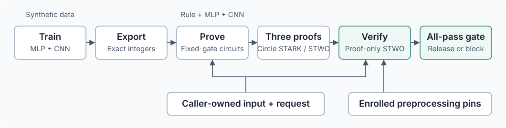

# Hallmark

**Train a classifier. Prove its exact computation. Verify the verdict.**

[](https://github.com/AbdelStark/hallmark/actions/workflows/check.yml)

[Run the proof demo](docs/DEMO.md) · [What is proved?](docs/PROOFS.md) · [Results](docs/RESULTS.md) · [Documentation](docs/README.md) · [Contribute](CONTRIBUTING.md)

Hallmark is an MIT-licensed research toolkit for verifiable text classification. It connects
synthetic training, exact integer inference and specialized cryptographic circuits
so a separate verifier can check classifier verdicts against a caller's expected
input, model and policy.

**The classifier demo works end to end, without hardware attestation.** It trains
an MLP and a contextual byte CNN, combines them with a literal rule, and verifies
real Groth16 proofs for all three over the same request. The circuits use gnark
and BLS12-381; verification uses a separate py-ecc implementation. There is no
general-purpose zkVM in this path.

This is research software. The demo uses authored synthetic data and prompts of
at most **96 UTF-8 bytes**. A valid proof establishes the admitted integer
computation; it does not establish that a classifier is a good safety policy.
The broader hardware-attested inference system remains unfinished.

## What exactly is proved?

For a fixed integer classifier and a particular prompt, Hallmark proves that the
classifier computes the stated pass/block verdict on the complete prompt bytes.
A **valid proof can prove a block**: proof validity and classifier approval are
separate outcomes.

The proof covers input hashing and integer inference, including the final threshold
comparison. Training supplies the weights; its history is not proved. The caller
checks request/model/key binding, and host code combines three verified verdicts
with `all-pass`. No LLM generates a response in this demo.

Read [the proof statement, public inputs and trust boundary](docs/PROOFS.md) for a
concrete example and the exact division between circuit checks and caller checks.

## What the demo does



The caller reconstructs the public inputs from its own transcript opening and
expected context. The prover's bundle cannot choose those expectations. The
controller pins each compiled circuit and verification key before proving.

| Classifier | Computation | Role in the demo |
|---|---|---|
| Literal rule | Complete byte scan for `BAD`, including chunk boundaries | Blocks the marker case |
| Trained MLP | Byte counts → four hidden ReLU units → score | Learned arithmetic baseline; insensitive to word order within a chunk |
| Trained CNN | Byte embeddings → width-24 convolution → ReLU → masked max pooling → score | Distinguishes an active action from the same action inside a quotation |

Each classifier sees the complete prompt admitted by this demo. Oversized inputs
are rejected, never silently truncated. The response is authored fixture text;
no LLM generates it and no proof claims otherwise.

The fixed three-case run produces:

| Case | Rule | MLP | CNN | Classifier gate |
|---|---|---|---|---|
| Benign action, quoted restricted action | Pass | Pass | Pass | `release: true` |
| Restricted action, quoted benign action | Pass | Pass | Block | `release: false` |
| Benign case prefixed with `BAD; ` | Block | Pass | Pass | `release: false` |

`release` is the demo's all-pass classifier decision. It is not authorization to
release a real model response. Results retain `qualified_backend: false` and
`hardware_claim: "not-accepted"`.

## Start here

### Train, prove and verify

On an **Apple Silicon Mac**, with Git, Make, curl and **uv 0.9.18** on `PATH`:

```sh
git clone https://github.com/AbdelStark/hallmark.git
cd hallmark
make e2e
```

One command prepares pinned Python/Go environments, trains both models, builds the
circuits, generates **nine real proofs** and checks them with the separate verifier.
It checks **18 cross-request substitutions** and **405 arithmetic cases**, then
prints the three decisions and the path to its result. Every run gets a fresh
local evidence directory; failures return nonzero and retain their logs.

Allow **12 GiB free storage** and roughly **20 minutes plus dependency/build time**
on the recorded M4 Max. No GPU, API token, cloud account, downloaded model weights
or private data is needed. See the [demo guide](docs/DEMO.md) for prerequisites,
progress, expected output, resource bounds and troubleshooting.

### Quick software smoke test

For a smaller check on Linux or macOS, from the checkout:

```sh
uv sync --locked --python 3.12
uv run --locked hallmark validate-data fixtures/smoke.jsonl
make check-conformance
```

Expect a dataset summary, then **156 matched software cases** and **32 unavailable
full-evidence obligations**. This smoke test checks software contracts; it does
not generate a proof. Core CI also covers CPython 3.13 and 3.14. Packages are not
published; use the checkout.

## Evidence, with its limits

| Question | Current evidence | What it does not establish |
|---|---|---|
| Can training reproduce the integer models? | Three fixed seeds; full/resumed checkpoints agree; repeated CNN exports and decisions match | Robustness to other runtimes, data or tasks |
| Does the CNN learn the synthetic scope task? | All three v2 seeds detect 50/50 positives; false positives are 0/50, 1/50 and 0/50 | Real-world safety or a population 1% false-positive rate |
| Can the three classifiers be proved together? | Original two campaigns: **18 real proofs**, **6 verified three-proof sets** | Authenticated compiler/enrollment or a trusted setup ceremony |
| Do the checks reject altered claims? | **36 cross-request substitutions rejected**; **810 arithmetic cases matched expected outcomes** | A security audit or proof of absence of implementation bugs |
| Is the full hybrid system complete? | Software contracts and bounded classifier proofs exist | Hardware provenance, protected response generation, B2 or operational hybrid acceptance |

The arithmetic corpus includes valid controls and malformed/rejected cases; its
810 cases are not 810 rejected attacks. The first CNN screen **failed** and remains
published. The second screen is a new experiment with fresh calibration/test
pairs, sharing a synthetic grammar and vocabulary. See [results and model/data
notes](docs/RESULTS.md) for counts, identities, costs and direct evidence links.

## How the project is organized

```text
src/hallmark/             Contracts, native integer runtimes, training and binding
scripts/                 Reproducible experiments and local validation commands
research/probes/gnark/   Dedicated Go proof circuits and negative fixtures
research/probes/py_ecc/  Separate proof decoder and pairing verifier
fixtures/                Authored synthetic data and frozen protocols
tests/                   Contract, arithmetic, mutation and distribution checks
docs/                    Walkthroughs, specifications and design decisions
research/                Current state, numeric evidence and chronological ledger
```

The [API reference](docs/spec/02-public-api.md) distinguishes supported library
interfaces from proposed commands. The research proof controllers run from source;
there is no production `verify-b` endpoint to deploy.

## Documentation

| I want to… | Read |
|---|---|
| Understand exactly what a proof establishes | [Proof statement and trust boundary](docs/PROOFS.md) |
| Run the whole classifier demo | [Demo walkthrough](docs/DEMO.md) |
| Assess the models, data and measured results | [Results and limitations](docs/RESULTS.md) |
| Find a contract, recipe or research record | [Documentation index](docs/README.md) |
| Understand the proposed full system | [Canonical specification](SPEC.md) |
| Reproduce or resume a research experiment | [Operations guide](docs/OPERATIONS.md) |
| Understand split, calibration and test rules | [Evaluation contract](docs/EVALUATION.md) |
| See what remains unfinished | [Current state](research/STATE.md) |

## Development

```sh
uv sync --locked --python 3.12
make check
make package-check
make check-train
make package-check-train
```

`make check` runs lock, lint, formatting, strict typing, tests, documentation and
software conformance checks. Core-only environments legitimately skip optional
training; the train gate requires execution. Package checks build and install
fresh wheel/sdist artifacts. CI also checks a fresh synthetic proof with the
separate arithmetic verifier; it does not run the full Mac demo or attest hardware.

Start with [CONTRIBUTING](CONTRIBUTING.md) for setup, focused checks and the PR
workflow. Changes to integer semantics or binding need rejection tests; changes
to data, thresholds or evaluation need a new experiment identity. Keep failures
and raw evidence. Never commit credentials, private transcripts, checkpoints or
local run directories.

## Security and licence

See [SECURITY](SECURITY.md) for trust assumptions and private reporting. Setup
custody, authenticated program/key enrollment, independent security/hiding review
and operational verifier integration remain open gates.

Hallmark is released under the **[MIT licence](LICENSE.md)**. Third-party software,
referenced datasets and model weights retain their own terms; see the
[dependency notices](docs/DEPENDENCIES.md). Packages and model checkpoints are
not published. Historical experiment records preserve their original licence
labels and hashes; [decision 0063](docs/decisions/0063-mit-license.md) records the
licence adoption without rewriting those artifacts.
