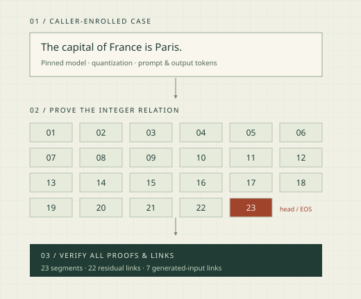
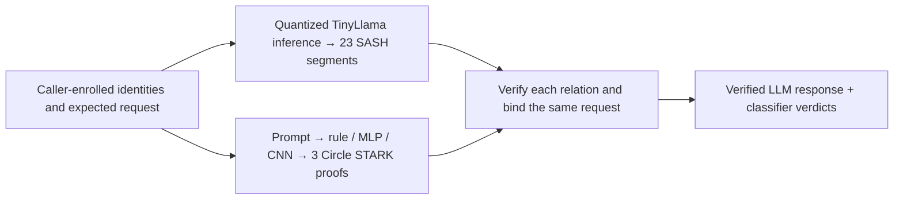

# Hallmark

**Circle STARK proofs of LLM inference and exact classifier decisions.**

[](https://abdelstark.github.io/hallmark/)
[](https://github.com/AbdelStark/hallmark/actions/workflows/check.yml)
[](docs/CIRCLE-CLASSIFIERS.md)
[](LICENSE.md)

[](https://huggingface.co/abdelstark/hallmark-byte-mlp)
[](https://huggingface.co/abdelstark/hallmark-contextual-byte-cnn)

[Quickstart](#quickstart) · [Benchmarks](#recorded-results-at-a-glance) · [Proof downloads](docs/REFERENCE-RUN.md#download-and-verify) · [Models on Hugging Face](#published-models) · [What is proved?](#what-exactly-is-proved) · [Architecture](docs/ARCHITECTURE.md) · [Documentation site](https://abdelstark.github.io/hallmark/)

Hallmark proves a complete short response from a pinned, quantized
**TinyLlama-1.1B** using **SASH Circle STARKs**, and proves rule, MLP and CNN
classifier decisions using dedicated **STWO Circle STARK** circuits.
A composed demo binds both to the same caller-owned request.

**LLM · 23 Circle proofs · 53.94 s GPU proving session · 3.40–3.53 s compiled-root Mac verification · 737.86 MB proof JSON.**

**Classifiers · 9 Circle proofs · 24.06 s final STWO proving · 0.807 s proof-only verifier processes · 18.06 MB proof JSON.**

[Actual proofs, logs, machines and verification commands](docs/REFERENCE-RUN.md) ·
[Reference artifacts](https://github.com/AbdelStark/hallmark/releases/tag/circle-reference-2026-10-28) ·
[Reference Discussion](https://github.com/AbdelStark/hallmark/discussions/133)

This is a working, fixed-case **research integrity MVP**. It uses specialized
inference proofs, with no general-purpose zkVM or hardware attestation.
Witness hiding, arbitrary prompts/models and production qualification are outside
the current scope. See [acceptance and limits](docs/MVP.md).

[](docs/LLM-PROOF.md#the-statement)

## Recorded results at a glance

Numbers below are from named Circle STARK component runs. **L1** is one retained
H200 SIMD/CUDA pair; **C1** is a fresh Mac classifier controller; **J1** is retained
LLM composition. They have different timing boundaries and are **not one measured
fresh end-to-end latency**. MB/GB are decimal; GiB is binary.
[Full stage tables and raw-file map](docs/REFERENCE-RUN.md).

### L1 — TinyLlama-1.1B, complete eight-token response through EOS

HF Jobs H200 profile: **one NVIDIA H200**, 23 provider vCPUs / 256 GB RAM,
four Rayon threads, Linux x86_64. Same host, inputs and parameters, CPU then GPU,
2026-10-26. All 23 proofs and 22 links verify; 69 proof/statement/claim files
match byte for byte. Preparation and the generated-kernel build are reused.

| All 23 proof segments | CPU / SIMD | GPU / CUDA |
|---|---:|---:|
| Trace-generation timers | 31.84 s | **32.14 s** |
| **Proving-session timers** | 547.75 s | **53.94 s** |
| ↳ Interaction work, **inside** session timer | 60.72 s | 36.95 s |
| Inline verification timers | 77.62 s | 34.40 s |
| **Complete prover segment commands** | 679.49 s | **155.89 s** |
| Separate full-grid **CPU** verifier on H200 host | 85.35 s | **84.32 s** |
| **Actual proof JSON, all 23 files** | 737,858,641 bytes | **737,858,641 bytes** |
| Sampled peak host RSS | 103.75 GB | 8.07 GB |
| Sampled peak GPU memory | — | 67.67 GiB |

SASH's session timer starts after trace generation and includes commitments and
interaction work. **Do not add its nested interaction timer.** Complete commands
also include loading, inline checks and serialization. The paired ratios are
10.15× for the session timer and 4.36× for complete commands; one pair does not
establish a latency distribution. Generated constraints use CUDA with zero CPU
constraint fallback; witness and interaction generation remain on CPU.

| Verification / enclosing stage | L1 measurement | Boundary |
|---|---:|---|
| Native Mac full-bundle verification | **3.40 / 3.53 s** | Per honest check on M4 Max **after compilation**, with enrolled shape roots compiled in |
| Fresh Linux full-bundle verification | **77.40 / 77.61 s** | Per honest check on a separate 8-vCPU / 32-GB worker; runtime shape preprocessing |
| Original generated-kernel build job | **1,815.94 s** | Earlier CPU build job’s running interval; 77 kernel shapes; not isolated compilation |
| Model-root command | **113.86 s** | Separate command before the matched segment runs |
| Complete cached-build benchmark | **2,086.78 s** | Both backends, fixtures, transfers, root/grid checks and Linux/Mac suites |
| Fresh witness preparation / isolated serialization | **Not separately measured in L1** | Preparation reused; serialization remains charged to complete commands |

Linux and native Mac verifiers share SASH crypto code but use different
preprocessing; these timings are not a matched speedup. Linux rejects all 14
mutations; native Mac rejects all 36. The 355,320,899-byte download is gzip
transport for the **737,858,641-byte proof payload plus statements/claims**.

[Download the actual LLM proofs](https://github.com/AbdelStark/hallmark/releases/download/circle-reference-2026-10-28/llm-proofs.tar.gz) ·
[Logs, machine/job records and every segment](docs/REFERENCE-RUN.md#l1-complete-tinyllama-response) ·
[GPU method and limits](docs/GPU-BENCHMARK.md).

### C1 — default Circle classifier workflow

**Apple M4 Max · 16 logical CPUs · 48 GiB RAM · macOS arm64 · four prover threads.**
One fresh instrumented default controller on 2026-10-28, with populated dependency
caches and an initially empty Rust target directory. It trains the frozen MLP/CNN
and proves all three classifiers on all three control requests.

| Stage | C1 measurement | Boundary |
|---|---:|---|
| MLP training/export | **1.95 s** | Complete child command |
| CNN training/export/screen | **172.94 s** | Complete child command |
| Rust prover / proof-only verifier builds | **24.82 / 9.57 s** | Two complete locked Cargo commands |
| Host witness construction | **15.613 s** | Nine witnesses; outside prover processes |
| Preprocessing/model commitment | **7.882 s** | Inside prover commands; repeated per proof |
| **Final STWO proving calls** | **24.061 s** | Nine final proof-generation calls; excludes preceding trace/commitment work |
| **Complete prover commands** | **50.028 s** | Parsing, all engine stages and serialization/write |
| **Fresh proof-only verifier commands** | **0.807 s** | Nine fresh processes; excludes native caller reconstruction |
| **Actual serialized proofs** | **18,063,779 bytes** | Nine canonical JSON proof files; excludes hex bundles, enrollment and logs |
| Proof campaign | **93.50 s** | Enrollment, witnesses, proving, checks and host work |
| **Complete observed controller** | **302.96 s** | Fresh training/build/proofs/checks; uv environment bootstrap is outside this timer |
| Maximum sampled worker-tree RSS | **23.45 GB** | Maximum across campaign workers, not sum of peaks |

Preprocessing and final proving sit **inside** the complete prover commands;
do not add both levels. Classifier `stark_proving` and LLM `prove_secs` have
different boundaries. Caller binding currently reruns native inference; proof-only
timings do not demonstrate a saving over rerunning these small models.
All **63 changed-public-input checks**, **18 substitutions** and **three roster
checks** reject. These are single-run observations, not timing distributions.

[Download actual classifier proofs and raw logs](https://github.com/AbdelStark/hallmark/releases/download/circle-reference-2026-10-28/reference-records.tar.gz) ·
[Every C1 stage and per-proof time/size](docs/REFERENCE-RUN.md#c1-default-classifier-workflow).

### J1 — 23 LLM proofs and three new Circle classifier proofs, one request

The actual retained-input composed command takes **266.29 s**, including fresh
native LLM compilation/checks and three new classifier proofs. Native LLM workflow:
**216.87 s**; classifier controller: **44.12 s**. The three classifier proofs total
**6,020,695 bytes**. The host join verifies them again and rejects **16 changed
bindings/rosters**. Integrity passes; verdicts `[1,1,0]` make policy release false.
It reuses LLM proof bytes and is **not fresh GPU proving**.
[Exact join, timings and files](docs/REFERENCE-RUN.md#j1-same-request-composition).

## What exactly is proved?

The current LLM case is:

```text
Prompt:   Name the capital of France in one short sentence.
Response: The capital of France is Paris.
```

| Path | Cryptographic statement | Caller responsibilities |
|---|---|---|
| **LLM — SASH Circle STARK** | The enrolled quantized model computes the complete greedy answer through EOS: embedding, every transformer layer, final normalization and output argmax, with all segment/token links checked | Enroll expected model, shape and calibration roots and the exact token case; check pinned tokenization/detokenization outside the circuit |
| **Classifiers — STWO Circle STARK** | The same rule, MLP and CNN arithmetic, complete 96-byte input and exact salted SHA-256 commitment; nine real proofs pass fresh verification | Enroll fixed circuit/preprocessing and backend-specific identities before proving; reconstruct expected public inputs and complete roster; [details](docs/CIRCLE-CLASSIFIERS.md) |
| **Composition — host verification** | Both verified relations refer to the same opened request | Check the common prompt/response context and combine verified classifier verdicts with `all-pass` |

A valid proof can establish a **block** verdict. Proof validity is separate from
classifier approval. Composed classifiers inspect the **prompt**; the response
is bound into their context, not classified. Training history is not proved.
The classifier caller currently reruns native inference to derive expected
verdicts, so this demo does not establish a verification saving over native rerun.

The frozen MLP always allows within the 96-byte demo limit; its
[integer score bound](research/evidence/mlp-domain-bound-2026-10-27.json) is
[−5600, −2338] against threshold 0. It exercises full MLP arithmetic, while the
rule and CNN supply block controls. [Model limits](docs/MODELS.md).

The LLM uses disclosed mixed quantization, `y-attnout-w12`; it is not a proof
of equivalence to the original floating-point model. The 23 segments form a linked
bundle, not a single recursive proof. Composition also joins proofs in host code.

**[LLM proof statement](docs/LLM-PROOF.md#the-statement)** ·
**[Classifier public inputs and trust boundary](docs/PROOFS.md)** ·
**[Composition and exact join](docs/COMPOSED-DEMO.md)**

## Architecture



The standalone classifier workflow uses authored response text and proves no LLM
generation. The composed workflow prepares the same frozen models and creates three Circle
proofs for the proved LLM request. Standalone controls are a separate command.

SASH is fetched as **hash-pinned upstream source** and invoked through CLI adapters,
rather than installed as a Python dependency or copied wholesale into this repo.
The CPU prover uses unchanged upstream Rust. The CUDA build adds generated
constraint kernels and a strict fallback guard; witness preparation and the
optional native Mac verifier have separate explicit patches.
See [source ownership and patches](docs/ARCHITECTURE.md#how-sash-is-integrated)
and [the GPU build](docs/GPU-BENCHMARK.md).

## Demo apps

Run the terminal or local web workbench from a checkout:

```sh
make demo-tui
make demo-web
```

Both use the same workflow controller and can view the same active run.
Follow observed stages, process-tree memory/CPU samples, logs, HF job status,
verification results and retained artifacts. The catalog covers classifiers,
the fixed TinyLlama response, retained-proof verification, composition and GPU
measurements. Paid workflows show their resource and cost bounds before launch.
[Setup, controls and extension guide](docs/WORKBENCH.md).

## Quickstart

Clone the source checkout; Python packages are not published:

```sh
git clone https://github.com/AbdelStark/hallmark.git
cd hallmark
```

### Train, prove and verify classifiers locally

Use an **Apple Silicon Mac**, Git, Make, **uv 0.9.18** and Rust
**nightly-2025-07-14**, with at least
**12 GiB free storage**. No GPU, token, cloud account or pretrained weights are needed.

```sh
make e2e
```

One command trains the MLP and byte CNN, exports the frozen integer graphs,
builds the locked STWO prover and proof-only verifier, and generates **nine Circle
STARK proofs**. It freshly verifies each proof and rejects **63 public-input
mutations, 18 cross-request substitutions and three invalid rosters**.

Expect the benign case to pass, the contextual case to be blocked by the CNN,
and the marker case to be blocked by the rule. Each invocation prints a fresh
`runs/` result path; failures return nonzero and preserve logs. Allow roughly
**several minutes plus the first Rust build**; allow the 30-GiB sampled worker
memory cap.
[Prerequisites, outputs and troubleshooting](docs/DEMO.md).

### Prove the complete pretrained LLM response

Use an **Apple Silicon Mac**, Git, Make, uv 0.9.18, **32 GB RAM**,
**16 GiB free storage**, and an HF account with Jobs access and prepaid credits.
Set `HF_TOKEN` in the environment or ignored `.env` file and check available credits:

```sh
make e2e-llm
```

This downloads the pinned 2.2-GB Apache-2.0 TinyLlama checkpoint, prepares the
quantized response/witnesses locally, then starts **three sequential paid HF CPU
jobs** to build, prove and verify, under a **$2.10 timeout-based cost ceiling**.
No local GPU is needed. Success includes two honest verifications and 14 rejected
mutations. [LLM run guide](docs/LLM-PROOF.md#run-it).

To verify retained proofs locally, use the printed run directory:

```sh
# Requires an existing Rust installation; one-time toolchain setup:
rustup toolchain install nightly-2025-07-14 --profile minimal
make verify-llm LLM_RUN=runs/llm-e2e-...
```

Native verification needs **8 GiB free storage** and no weights or HF credentials.
Builds may download locked dependencies; verification itself is offline.
Read [shape enrollment and its trust boundary](docs/LLM-PROOF.md#verify-retained-proofs-on-your-mac),
including optional signed parameters.

### Reproduce the H200 GPU measurement

With the same Mac/Rust prerequisites, **16 GiB free storage**, HF credits and a
completed, caller-owned LLM run, check the live prepaid balance and pass it explicitly:

```sh
make benchmark-llm-gpu \
  LLM_RUN=/path/to/completed/llm-e2e-run \
  GPU_CREDIT_BALANCE_USD=YOUR_CHECKED_BALANCE
```

This starts **paid HF CPU/H200 jobs under a $5 single-run ceiling**. It reuses
frozen public witnesses, builds generated CUDA kernels, compares SIMD/CUDA on
one H200, and verifies GPU proofs in fresh CPU/Mac processes.
`GPU_BUILD_RUN=/path/to/llm-gpu-run` can reuse a matching caller-owned build.
[Run plan, costs, cache admission and failures](docs/GPU-BENCHMARK.md).

### Bind LLM generation and classifier proofs

```sh
make e2e-composed
```

This runs both workflows and binds three new classifier proofs to the proved
LLM request. It needs their combined prerequisites and **32 GiB free storage**.
Without retained inputs it starts the paid LLM jobs. Pass
`LLM_RUN=… CLASSIFIER_RUN=…` to reuse caller-owned runs without new cloud jobs;
LLM proofs are freshly verified and three Circle classifier proofs are always
new. Retained LLM composition needs **12 GiB free** plus build-cache headroom;
`CLASSIFIER_RUN` reuses only hash-pinned model exports, never saved pass flags.
[Composition walkthrough and signed enrollment](docs/COMPOSED-DEMO.md).

### Smaller software check on Linux or macOS

```sh
uv sync --locked --python 3.12
uv run --locked hallmark validate-data fixtures/smoke.jsonl
make check-conformance
```

Expect a dataset summary, then **156 matched software cases** and **32 unavailable
full-evidence obligations**. This checks software contracts and generates no proof.
Core CI also covers CPython 3.13 and 3.14.

## Published models

The exact trained seed-17 classifiers used by the proved demo are available on
**Hugging Face**, with model cards, original JSON checkpoints, quantized weights,
native exports, evaluation records and hash manifests:

| Model | Architecture | Model card and weights |
|---|---|---|
| Byte MLP | 1,033 parameters; byte counts → 4 ReLU units → score | [abdelstark/hallmark-byte-mlp](https://huggingface.co/abdelstark/hallmark-byte-mlp) |
| Contextual byte CNN | 4,161 parameters; byte embeddings → causal convolution → masked max → score | [abdelstark/hallmark-contextual-byte-cnn](https://huggingface.co/abdelstark/hallmark-contextual-byte-cnn) |

Both are MIT-licensed synthetic research models, trained from scratch. These
are Hallmark JSON/CBOR exports, not Transformers models. The cards distinguish
arithmetic checks from held-out synthetic results and real-world quality.
[Download and run the models](docs/MODELS.md#download-and-run), or inspect the
[immutable revisions and verification receipt](docs/MODELS.md#immutable-identities).
Native inference does not generate a proof; `make e2e` trains/reproduces the
models and generates fresh proofs. TinyLlama is an upstream pretrained model,
not a Hallmark-trained release.

## Limits and research status

- **Fixed inference case.** The complete short TinyLlama response is verified;
  arbitrary prompts/models are not supported by this pipeline.
- **Public-witness integrity.** No witness-hiding or hardware-provenance claim.
  Caller enrollment is a trust boundary; a prover cannot authenticate its own parameters.
- **Synthetic classifiers.** Inputs are limited to **96 UTF-8 bytes** and oversized
  prompts reject. Synthetic accuracy does not establish a useful safety policy.
  The frozen CNN blocks the ordinary LLM prompt in the composed demo.
- **Research enrollment and review.** Circle proofs use caller-enrolled
  public preprocessing. The backend has no independent security
  qualification. `qualified_backend: false`, `hiding_claim: false` and
  `hardware_claim: "not-accepted"` remain explicit.
- **Measured boundaries.** Proof size excludes enrollment/keys. GPU timings are
  a single matched observation; native verification uses compiled shape roots.
  Failures and source/environment hashes remain in the research record.

The [MVP acceptance matrix](docs/MVP.md) distinguishes completed integrity work
from the original private/hardware v1 roadmap. The
[Circle STARK classifier epic #112](https://github.com/AbdelStark/hallmark/issues/112)
completed rule/MLP/CNN proofs and retained-LLM composition.
[Decision 0087](docs/decisions/0087-remove-pairing-backend.md) makes Circle the
only classifier proof backend.

## Documentation

| I want to… | Read |
|---|---|
| Download actual proofs and audit every stage/machine | [Reference runs and verification](docs/REFERENCE-RUN.md) |
| Trace commands, proof flows and source ownership | [Architecture](docs/ARCHITECTURE.md) |
| Inspect the exact LLM relation and reproduction | [LLM proof guide](docs/LLM-PROOF.md) |
| Reproduce GPU timings or audit their boundaries | [GPU benchmark](docs/GPU-BENCHMARK.md) |
| Inspect classifier circuits, public inputs and caller checks | [Classifier proofs](docs/PROOFS.md) |
| Inspect the STWO rule/MLP/CNN path | [Circle STARK classifiers](docs/CIRCLE-CLASSIFIERS.md) |
| Download trained weights and reproduce native inference | [Published models, cards and pinned revisions](docs/MODELS.md) |
| Assess model/data quality, counts and failed screens | [Results and limitations](docs/RESULTS.md) |
| Run the joined workflow | [Composed demo](docs/COMPOSED-DEMO.md) |
| Find a contract, recipe or research record | [Documentation index](docs/README.md) |
| Reproduce or resume a research experiment | [Operations](docs/OPERATIONS.md) |
| See completed work and open research gates | [Current state](research/STATE.md) |

## Development and contributions

Build the [documentation site](https://abdelstark.github.io/hallmark/) with
`make docs`, or preview it with `make docs-serve`. Its toolchain is independently
locked; see [site maintenance](docs/DOCUMENTATION.md).

```sh
uv sync --locked --python 3.12
make check
make package-check
# For training changes:
make check-train
make package-check-train
```

`make check` covers lock, lint, formatting, strict typing, tests, documentation
and software conformance. A core environment may skip optional training;
the train gate requires execution. Package checks build/install fresh wheel and
sdist artifacts. CI verifies a fresh Circle gate proof in a separate verifier
process; it does not run paid GPU jobs or the full Mac demos.

| Path | Responsibility |
|---|---|
| `src/hallmark/` | Contracts, native integer runtimes, training and binding |
| `scripts/` | Experiment controllers, reproducible workflows and validation |
| `research/probes/sash/` | Pinned SASH adapters, patches and fixed LLM case |
| `fixtures/` · `tests/` | Synthetic data, frozen protocols, arithmetic and rejection checks |
| `docs/` · `research/` | Guides, design decisions, numeric evidence and ledger |

Start with [CONTRIBUTING](CONTRIBUTING.md). Arithmetic/binding changes need
rejection tests; data/evaluation changes need a new experiment identity.
The [supported API](docs/spec/02-public-api.md) separates implemented interfaces
from proposed commands. Keep raw evidence and failures; never commit credentials,
private transcripts, checkpoints or local runs.

## Security and licence

Read [SECURITY](SECURITY.md) for trust assumptions and private vulnerability
reporting. [Open an issue](https://github.com/AbdelStark/hallmark/issues) for
reproducibility problems or scoped improvements; include the command, source
revision and sanitized failure log.

Hallmark is **[MIT licensed](LICENSE.md)**. Third-party software, data and model
weights retain their own terms; see [dependency notices](docs/DEPENDENCIES.md).
Historical evidence keeps its original licence labels and hashes;
[decision 0063](docs/decisions/0063-mit-license.md) records adoption without
rewriting artifacts.
