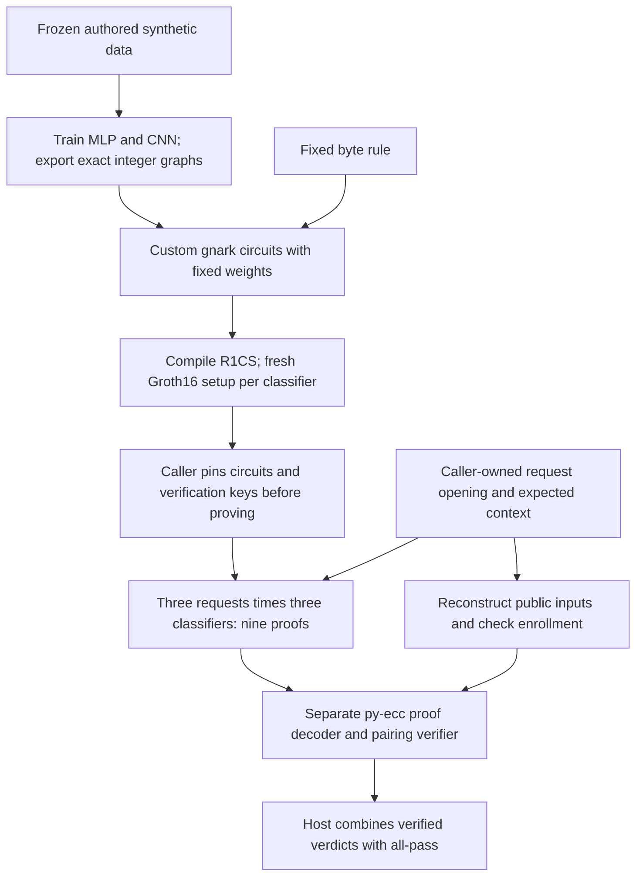
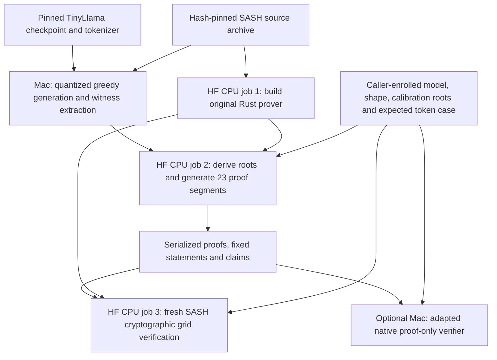
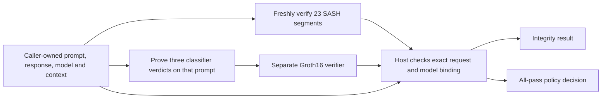

# Architecture: what runs, what is proved

Hallmark has two working proof backends: **dedicated gnark/Groth16 circuits for
classifiers** and **SASH Circle STARK proofs for a quantized TinyLlama response**.
The composed workflow checks both against one caller-owned request. It joins
verified results in host code; it does not recursively aggregate their proofs.

## Choose the workflow

| Command | Actual computation | Proofs and verification | Where it runs |
|---|---|---|---|
| `make e2e` | Train/export an MLP and CNN; evaluate them plus a fixed rule on three synthetic prompts | **9 Groth16 proofs**, checked by separate py-ecc arithmetic | Mac; no LLM, credentials or paid jobs |
| `make e2e-llm` | Generate the fixed eight-token TinyLlama answer, including EOS | **23 SASH proof segments**, linked and verified by SASH | Mac preparation; three sequential paid HF **CPU** jobs |
| `make verify-llm LLM_RUN=…` | Check retained LLM proofs; no new inference or proving | Same 23 segments, using an adapted native verifier | Mac; no weights, full witness or HF credentials |
| `make benchmark-llm-gpu …` | Reuse frozen public witnesses; compare complete SIMD and CUDA proving | Same 23 SASH segments per backend, byte equality and fresh CPU/Mac verification | HF CPU build, one H200 measurement job, separate CPU verification, Mac verification |
| `make e2e-composed` | Fresh LLM workflow, fresh classifier preparation, then classify the LLM prompt | **23 SASH segments + 12 Groth16 proofs**: 9 controls and 3 for the LLM request | Both workflows plus fresh native LLM verification |
| `make e2e-composed LLM_RUN=… CLASSIFIER_RUN=…` | Reuse caller-owned preparation; freshly verify LLM proofs and prove classifiers for that request | Retained **23 SASH segments + 3 new Groth16 proofs/setups** | Mac; no paid jobs or checkpoint download |

These are counts for the current fixed cases, not arbitrary-model support.
See [classifier prerequisites](DEMO.md), [LLM prerequisites and cost ceiling](LLM-PROOF.md#run-it)
and [composition options](COMPOSED-DEMO.md#run-the-workflow) before running them.
The [GPU measurement guide](GPU-BENCHMARK.md) gives its separate cost bounds,
host witness-generation paths, generated CUDA constraints, strict zero-fallback
checks, device sampling and cache policy.

## Classifiers: `make e2e`



For the MLP and CNN the inference relation is:

```text
x = complete admitted prompt bytes                 # 0–96 UTF-8 bytes
score = fixed_integer_classifier(x)
verdict = 1 if score < threshold else 0             # equality blocks
salted_SHA256(canonical_input(x)) = expected_input_digest
```

The literal rule passes exactly when `BAD` appears nowhere, including across
chunk boundaries. The circuits constrain complete input coverage, lengths,
padding, input hashing, integer operations/ranges/rounding, activations, masks,
aggregation and verdict. Weights are circuit constants. Training history is
outside the proof.

There are **100 public fields**: context digest (32 bytes), classifier identity
(32), input digest (32), unit count, chunk count, encoded signed threshold and
verdict. Context and classifier digests are bound public fields, not identities
reconstructed inside the circuit. The caller checks their meaning against its
own request, enrolled program and key. Salt derivation is also a caller check.
See [the exact statement and trust boundary](PROOFS.md).

The current caller **reruns native classifier inference** to derive expected
verdicts. The workflow therefore does not demonstrate a verification cost saving
over rerunning these small models. The separate py-ecc verifier checks the actual
Groth16 equations; it does not share gnark's verifier implementation.

The standalone response is authored fixture text, not generated by an LLM.
Classifiers inspect the **prompt only**. In composition, the response is bound
into their request context; it is not classified.

Implementation: [controller](../scripts/run_e2e.py),
[common-request proving](../scripts/run_trained_common.py),
[custom circuits and Groth16 calls](../research/probes/gnark/graph.go),
[separate verifier](../research/probes/py_ecc/README.md).
Groth16 uses BLS12-381 and a circuit-specific setup. Fresh local setup is research
setup, not an independently reviewed ceremony.

## LLM: `make e2e-llm`



**Yes: this produces and cryptographically verifies real SASH proofs of the
disclosed quantized LLM inference.** It is more than a native rerun or hash
receipt. The current case is TinyLlama-1.1B-Chat-v1.0 at a pinned revision with
the named mixed quantization profile `y-attnout-w12`; that name does not mean
uniform 12-bit weights. It does not prove equivalence to unmodified floating-point
Transformers inference.

The prompt has 25 tokens. Eight output tokens spell “The capital of France is
Paris.” and EOS. One 32-position input block contains the prompt plus the first
seven generated tokens. Output positions 24–31 produce those eight next-token
IDs. Verification checks the seven generated-input/previous-argmax equalities,
closing the autoregressive chain through EOS.

The bundle covers all 22 transformer layers plus the final normalization/output
head: **23 segments and 22 residual links**. Embedding is bound in the first
segment. Each segment's proof is checked, followed by the model roots and
inter-segment/token links. `boundary-grid --verify` performs these checks;
`--expect-token-links 0` describes the inter-block axis of this single-block
case, not an absence of generated-token checks. The result is a linked bundle,
not a single recursive proof. See [the full LLM statement](LLM-PROOF.md#the-statement).

### How SASH is integrated

Hallmark uses **pinned upstream source plus command-line adapters**. It neither
installs SASH as a Hallmark Python dependency nor maintains a tracked full copy
of SASH. The controller downloads a hash/size-checked archive of
[upstream commit `eb95bfa`](https://github.com/sg-ai-safety-hub/zk-inference-prover/tree/eb95bfa887299d1637550228d42086c27cbb2b3b)
into an ignored run directory. Upstream includes its `nitroo/` Circle STARK
implementation and locked Rust/Python dependencies.

| Component | Ownership and modifications |
|---|---|
| Local witness preparation | Upstream Python harness plus Hallmark's [preparation adapter](../research/probes/sash/prepare_native.py) and [exact-GEMM patch](../research/probes/sash/exact-gemm.patch). The patch preserves the exact float64 accumulator instead of rounding it through float32. |
| Linux CPU prover/verifier | Built from the **unchanged pinned upstream source**, separately from the patched local witness checkout. Hallmark orchestrates `model-roots`, per-segment `compose`, serialization and `boundary-grid --verify`. |
| Linux CUDA prover | Uses the same pinned source, plus upstream-generated constraint kernels and Hallmark's [strict fallback/build patch](../research/probes/sash/kernel-guard.patch). Modified/generated source and binary hashes are retained; witness/interaction generation stays on CPU. See the [GPU build and measurements](GPU-BENCHMARK.md#generated-constraint-result). |
| Native Mac verifier | **Adapted upstream Rust**, using [the native-verifier patch](../research/probes/sash/native-verifier.patch): avoids CUDA linkage, restricts the CLI to verification, uses compiled enrolled shape roots and strengthens boundary validation. It does not rederive shape trees at runtime. |
| Case admission and orchestration | Hallmark's [case](../research/probes/sash/response-case.json), [controller](../scripts/run_llm_e2e.py), [proving adapter](../research/probes/sash/prove_response.py), [verification adapter](../research/probes/sash/verify_response.py) and [native controller](../scripts/verify_llm.py). These enforce caller expectations and reject incomplete/unsupported claims. |

The proof-only worker receives serialized proofs/statements/claims and expected
public parameters, without checkpoint weights or the full witness. It runs the
real verifier in fresh processes. This is the **same SASH verifier implementation**,
not an independently developed verifier. The optional native variant shares the
cryptographic checks but changes public preprocessing/trust: its compiled shape
roots must be admitted by the caller. Its faster recorded timing is not a matched
backend speedup.

Tokenizer/chat-template/detokenization checks, checkpoint-to-quantized preparation
and initial root provisioning remain host responsibilities. A proof binds the
enrolled quantized relation; it cannot authenticate its own enrollment. Optional
[signed enrollment](LLM-PROOF.md#verify-a-signed-parameter-enrollment) requires a
signer's public key supplied through an independently authenticated channel.
Neither implementation has an independent security qualification or a
witness-hiding claim. The retained fresh run's serialized proof files total
737,858,641 bytes; proof-only verification is not a claim of tiny artifacts.
[Recorded results](LLM-PROOF.md#measured-results) give the measurement context.

## Composition: one request, two verified relations



The [composed controller](../scripts/run_composed.py) first verifies LLM inference,
then proves all three classifier decisions with the same opened request/model
context. It checks exact roster/coverage and binding; no saved `passed` flag is
accepted in place of verification. A valid proof of a blocking verdict remains
valid. The frozen synthetic CNN blocks the ordinary France prompt, so the current
composed case has verified integrity and `release: false`.

This is host composition, not protected response release or hardware provenance.
It proves computation under admitted parameters, not policy quality, authentic
capture, training history, operational authorization or real-world safety.

## Why two backends? What changes next?

The split reflects implementation history, **not a matched performance result**.
Dedicated gnark classifier circuits were implemented first, including complete
SHA-256/input handling and the exact integer operators. SASH was integrated later
for its supported Llama inference relation. There is currently no Circle STARK
adapter for Hallmark's exact rule/MLP/CNN relations; switching requires a real
relation port and verifier/enrollment integration, not a command-line flag.

| Current path | Useful property | Remaining trade-off |
|---|---|---|
| gnark/Groth16 classifiers | Complete existing circuits and separate py-ecc verification; 292-byte serialized proofs in this profile | Circuit-specific trusted setup; local setup has not undergone an independent ceremony |
| SASH Circle STARK LLM | Working specialized quantized transformer proofs; no general-purpose VM | Large fixed-case bundle, public parameter enrollment and shared prover/verifier implementation |
| Circle STARK classifiers | **Planned**, not implemented | Must prove the same complete relation before a meaningful comparison |

There is **no matched classifier benchmark** establishing which proof backend is
better. Comparing the tiny classifier proofs with the 1.1B LLM's proof size or
timings would compare different workloads.

The new [Circle STARK classifier epic #112](https://github.com/AbdelStark/hallmark/issues/112)
tracks the implementation and comparison:

1. [#113](https://github.com/AbdelStark/hallmark/issues/113): freeze/replay the identical relation, exports, inputs, failures and measurement protocol.
2. [#114](https://github.com/AbdelStark/hallmark/issues/114): complete byte-rule proof, including the existing SHA-256 commitment and caller binding.
3. [#115](https://github.com/AbdelStark/hallmark/issues/115): exact trained integer MLP proof.
4. [#116](https://github.com/AbdelStark/hallmark/issues/116): complete contextual byte CNN proof.
5. [#117](https://github.com/AbdelStark/hallmark/issues/117): common workflow, composed request and repeated matched benchmarks against gnark and native execution.

The first implementation evaluates reuse of SASH's Circle STARK engine separately
from its Llama application; no engine choice or speed advantage is presumed.
Benchmarks must separate setup/preprocessing, witness preparation, proving,
serialization, proof-only verification, caller binding/native rerun, total time,
memory and artifact sizes, with explicit security parameters and resource caps.
The epic is integrity-only. It does not reopen the completed [MVP](MVP.md) or
silently satisfy the broader private/hardware v1 requirements.
