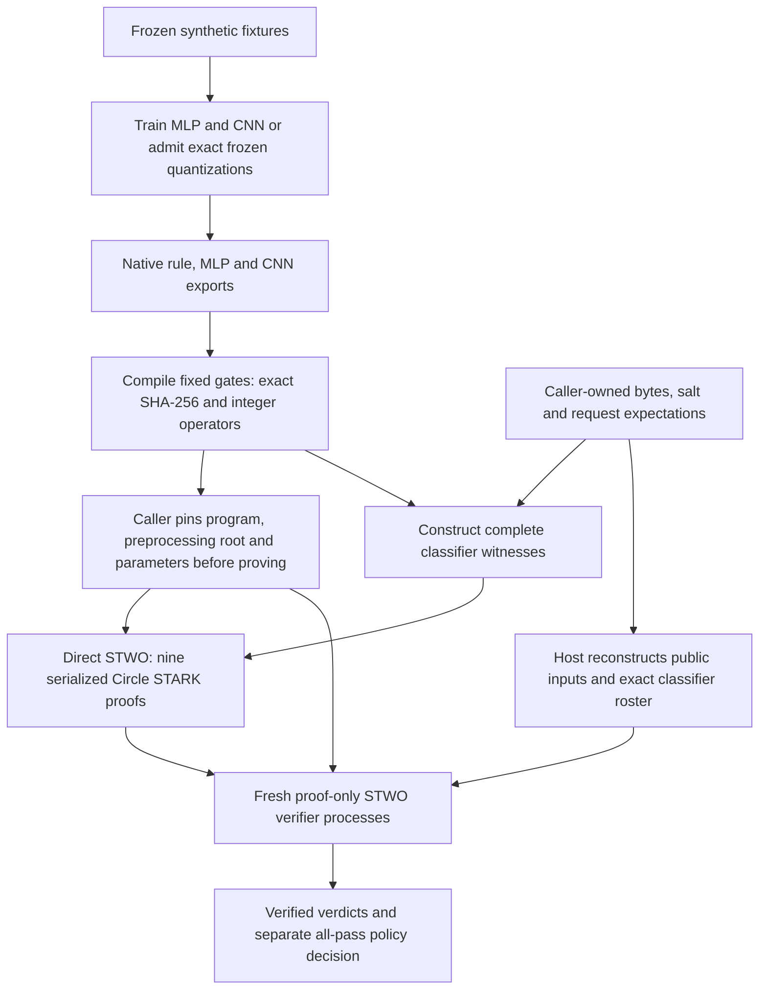
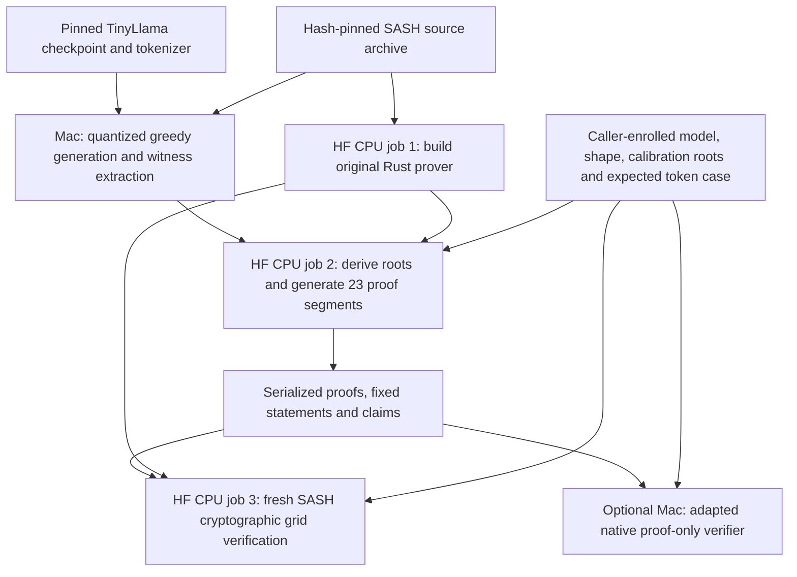
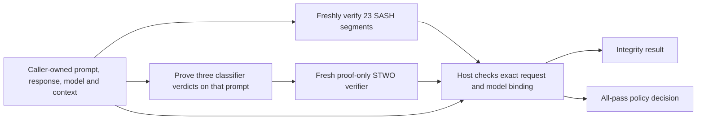

# Architecture: what runs, what is proved

Hallmark has two provers and one verifier role. **SASH** proves quantized
TinyLlama inference; **direct STWO** proves the rule, MLP and CNN classifiers.
Both are Circle STARKs. The caller pins every model, program and parameter
before proving, and the verifier checks each proof against those pins. The
composed workflow then checks, in host code, that both proofs refer to the same
request; it does not aggregate them recursively.
[Decision 0090](decisions/0090-remove-pairing-backend.md) makes Circle the only
classifier backend; models, arithmetic and research status are unchanged.

Three roles, kept apart on purpose:

- **Caller.** Owns the expected request and enrolls model roots, programs and
  proof parameters before any proof exists. Enrollment is the trust anchor.
- **Prover.** Runs the computation, builds the witness and produces proofs. It
  is trusted with nothing; a root it supplies by itself proves nothing.
- **Verifier.** Receives proofs, the caller's enrollment and public inputs.
  Never weights, witnesses or native traces.

## Choose the workflow

| Command | Actual computation | Proofs and verification | Where it runs |
|---|---|---|---|
| `make e2e` | Train/export an MLP and CNN; evaluate them plus a fixed rule on three synthetic prompts | **9 STWO Circle STARK proofs**, checked by fresh proof-only processes | Mac; no LLM, credentials or paid jobs |
| `make e2e-llm` | Generate the fixed eight-token TinyLlama answer, including EOS | **23 SASH proof segments**, linked and verified by SASH | Mac preparation; three sequential paid HF **CPU** jobs |
| `make verify-llm LLM_RUN=…` | Check retained LLM proofs; no new inference or proving | Same 23 segments, using an adapted native verifier | Mac; no weights, full witness or HF credentials |
| `make benchmark-llm-gpu …` | Reuse frozen public witnesses; compare complete SIMD and CUDA proving | Same 23 SASH segments per backend, byte equality and fresh CPU/Mac verification | HF CPU build, one H200 measurement job, separate CPU verification, Mac verification |
| `make e2e-composed` | Fresh LLM workflow, fresh classifier preparation, then classify the LLM prompt | **23 SASH segments + 3 STWO Circle classifier proofs** | Both workflows plus fresh native LLM verification |
| `make e2e-composed LLM_RUN=… CLASSIFIER_RUN=…` | Reuse caller-owned preparation; freshly verify LLM proofs and prove classifiers for that request | Retained **23 SASH segments + 3 new Circle classifier proofs** | Mac; no paid jobs or checkpoint download |

These are counts for the current fixed cases, not arbitrary-model support.
See [classifier prerequisites](DEMO.md), [LLM prerequisites and cost ceiling](LLM-PROOF.md#run-it)
and [composition options](COMPOSED-DEMO.md#run-the-workflow) before running them.
The [GPU measurement guide](GPU-BENCHMARK.md) gives its separate cost bounds,
host witness-generation paths, generated CUDA constraints, strict zero-fallback
checks, device sampling and cache policy.

## Classifiers: `make e2e`

Each of the nine proofs states the same thing about one prompt and one classifier:

The detailed data flow, including where caller inputs enter:

The graphs constrain the complete 96-byte input, salted canonical SHA-256
commitment and integer decisions. The 100 logical public
fields use 103 M31 transport values: two threshold limbs replace one 32-bit
value, and public zero/one wires supply the other two values. Context semantics
and native expectation reconstruction remain caller checks.

This path uses the pinned **STWO 2.2.0 dependency**, with Hallmark's gate AIR,
LogUp wiring and SHA/integer/classifier compiler. It does not run SASH's Llama
application or a general-purpose VM. Caller-enrolled public preprocessing
supplies no security or witness-hiding claim. The frozen MLP is always-allow within this input domain;
the rule and CNN provide the workflow's block controls.

The [Circle guide](CIRCLE-CLASSIFIERS.md) gives source ownership, concrete proof
parameters, commands and conformance failures.
The [composed controller](../scripts/run_circle_composed.py) joins three Circle classifier proofs to the
retained SASH LLM bundle: all 26 proofs and 22 residual links verify freshly,
with 16 changed-binding rejections. This remains host composition.

Orchestration is [run_circle_e2e.py](../scripts/run_circle_e2e.py).
[Native preparation](../scripts/circle_inputs.py) validates the fixed model hashes
and creates caller-owned controls. The [proof driver](../scripts/run_circle_classifiers.py)
compiles all gates, pins binary/source identities and checks the independently
admitted enrollment root **before proving**. It generates nine proofs, freshly
verifies each, rejects 63 changed public statements, 18 cross-request substitutions
and three invalid rosters, and checks native/circuit trace parity.

The exact relation is complete integer inference plus salted canonical SHA-256
input hashing; training history is outside the proof. See [the public statement](PROOFS.md).
Caller reconstruction binds context, model, classifier and policy; the caller
currently reruns native inference to derive expected verdicts. This is not yet
a demonstration of cheaper verification than rerunning these small classifiers.

## LLM: `make e2e-llm`

The detailed data flow:

**Yes: this produces and cryptographically verifies real SASH proofs of the
disclosed quantized LLM inference.** It is more than a native rerun or hash
receipt. The current case is TinyLlama-1.1B-Chat-v1.0 at a pinned revision with
the named mixed quantization profile `y-attnout-w12`; that name does not mean
uniform 12-bit weights. It does not prove equivalence to unmodified floating-point
Transformers inference.

The prompt has 25 tokens. Eight output tokens spell “The capital of France is
Paris.” and EOS. One 32-position input block contains the prompt plus the first
seven generated tokens. Output positions 24–31 produce those eight next-token
IDs. Verification checks the seven generated-input/previous-argmax equalities,
closing the autoregressive chain through EOS.

The bundle covers all 22 transformer layers plus the final normalization/output
head: **23 segments and 22 residual links**. Embedding is bound in the first
segment. Each segment's proof is checked, followed by the model roots and
inter-segment/token links. `boundary-grid --verify` performs these checks;
`--expect-token-links 0` describes the inter-block axis of this single-block
case, not an absence of generated-token checks. The result is a linked bundle,
not a single recursive proof. See [the full LLM statement](LLM-PROOF.md#the-statement).

### How SASH is integrated

Hallmark uses **pinned upstream source plus command-line adapters**. It neither
installs SASH as a Hallmark Python dependency nor maintains a tracked full copy
of SASH. The controller downloads a hash/size-checked archive of
[upstream commit `eb95bfa`](https://github.com/sg-ai-safety-hub/zk-inference-prover/tree/eb95bfa887299d1637550228d42086c27cbb2b3b)
into an ignored run directory. Upstream includes its `nitroo/` Circle STARK
implementation and locked Rust/Python dependencies.

| Component | Ownership and modifications |
|---|---|
| Local witness preparation | Upstream Python harness plus Hallmark's [preparation adapter](../research/probes/sash/prepare_native.py) and [exact-GEMM patch](../research/probes/sash/exact-gemm.patch). The patch preserves the exact float64 accumulator instead of rounding it through float32. |
| Linux CPU prover/verifier | Built from the **unchanged pinned upstream source**, separately from the patched local witness checkout. Hallmark orchestrates `model-roots`, per-segment `compose`, serialization and `boundary-grid --verify`. |
| Linux CUDA prover | Uses the same pinned source, plus upstream-generated constraint kernels and Hallmark's [strict fallback/build patch](../research/probes/sash/kernel-guard.patch). Modified/generated source and binary hashes are retained; witness/interaction generation stays on CPU. See the [GPU build and measurements](GPU-BENCHMARK.md#generated-constraint-result). |
| Native Mac verifier | **Adapted upstream Rust**, using [the native-verifier patch](../research/probes/sash/native-verifier.patch): avoids CUDA linkage, restricts the CLI to verification, uses compiled enrolled shape roots and strengthens boundary validation. It does not rederive shape trees at runtime. |
| Case admission and orchestration | Hallmark's [case](../research/probes/sash/response-case.json), [controller](../scripts/run_llm_e2e.py), [proving adapter](../research/probes/sash/prove_response.py), [verification adapter](../research/probes/sash/verify_response.py) and [native controller](../scripts/verify_llm.py). These enforce caller expectations and reject incomplete/unsupported claims. |

The proof-only worker receives serialized proofs/statements/claims and expected
public parameters, without checkpoint weights or the full witness. It runs the
real verifier in fresh processes. This is the **same SASH verifier implementation**,
not an independently developed verifier. The optional native variant shares the
cryptographic checks but changes public preprocessing/trust: its compiled shape
roots must be admitted by the caller. Its faster recorded timing is not a matched
backend speedup.

Tokenizer/chat-template/detokenization checks, checkpoint-to-quantized preparation
and initial root provisioning remain host responsibilities. A proof binds the
enrolled quantized relation; it cannot authenticate its own enrollment. Optional
[signed enrollment](LLM-PROOF.md#verify-a-signed-parameter-enrollment) requires a
signer's public key supplied through an independently authenticated channel.
Neither implementation has an independent security qualification or a
witness-hiding claim. The retained fresh run's serialized proof files total
737,858,641 bytes; proof-only verification is not a claim of tiny artifacts.
[Recorded results](LLM-PROOF.md#measured-results) give the measurement context.

## Composition: one request, two verified relations

The [composed controller](../scripts/run_circle_composed.py) first verifies LLM inference,
then proves all three classifier decisions with the same opened request/model
context. It checks exact roster/coverage and binding; no saved `passed` flag is
accepted in place of verification. A valid proof of a blocking verdict remains
valid. The frozen synthetic CNN blocks the ordinary France prompt, so the current
composed case has verified integrity and `release: false`.

This is host composition, not protected response release or hardware provenance.
It proves computation under admitted parameters, not policy quality, authentic
capture, training history, operational authorization or real-world safety.

## Trade-offs and next steps

SASH and direct STWO are specialized applications within the same proof family,
not interchangeable prover binaries.

| Current path | Useful property | Remaining trade-off |
|---|---|---|
| SASH Circle STARK LLM | Working specialized quantized transformer proofs; no general-purpose VM | Large fixed-case bundle, public parameter enrollment and shared prover/verifier implementation |
| STWO Circle STARK classifiers | Complete repeated rule/MLP/CNN workflow and retained-LLM join; exact input hashing and integer operators | Higher memory and much larger JSON proofs; repeated per-proof preprocessing; no backend qualification |

Classifier and 1.1B LLM proof sizes/timings remain different workloads.

The [Circle STARK classifier epic #112](https://github.com/AbdelStark/hallmark/issues/112)
tracks the implementation:

1. [#113](https://github.com/AbdelStark/hallmark/issues/113): freeze/replay the identical relation, exports, inputs, failures and measurement protocol.
2. [#114](https://github.com/AbdelStark/hallmark/issues/114): complete byte-rule proof, including the existing SHA-256 commitment and caller binding.
3. [#115](https://github.com/AbdelStark/hallmark/issues/115): exact trained integer MLP proof.
4. [#116](https://github.com/AbdelStark/hallmark/issues/116): complete contextual byte CNN proof.
5. [#117](https://github.com/AbdelStark/hallmark/issues/117): common workflow, composed request and repeated benchmarks.

The classifier implementation uses direct STWO 2.2.0 as a dependency, separately
from SASH's pinned Llama application/fork. It adapts the upstream gate-AIR/LogUp
patterns and adds Hallmark's own SHA-256/integer/classifier circuits. The
[source map](CIRCLE-CLASSIFIERS.md#code-and-dependency-ownership) explains ownership.
The epic is integrity-only. It does not reopen the completed [MVP](MVP.md) or
silently satisfy the broader private/hardware v1 requirements.
