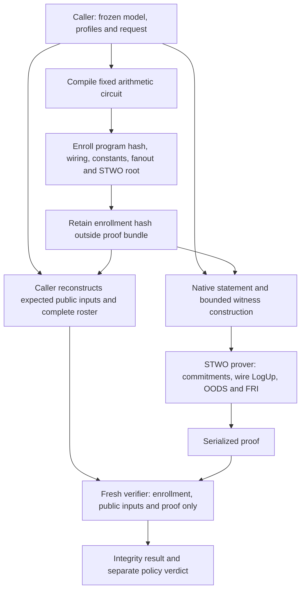
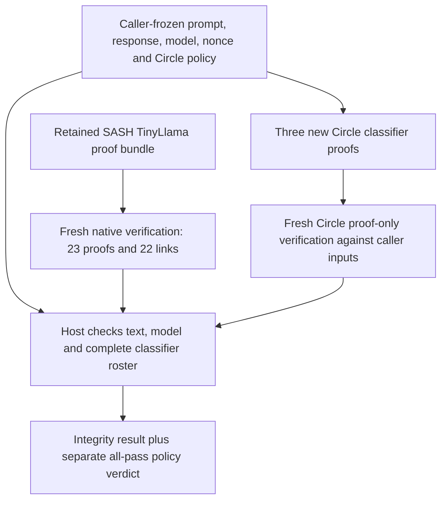

# Experimental Circle STARK classifier proofs

The new backend produces real, serialized STWO proofs for the existing literal
rule, four-hidden-unit integer MLP and contextual byte CNN. A fresh verifier
process checks each proof using enrollment and public inputs retained by the
caller. It does not receive the witness, model checkpoint or native execution
trace.

The [acceptance record](../research/evidence/circle-classifiers-acceptance-2026-10-27.json)
contains nine passing proofs: all three classifiers on each of the three frozen
requests. The verdicts match the native/gnark workflow. All 63 direct public-input
mutations, 18 cross-request substitutions and three invalid rosters reject.
A second acceptance run confirms those counts. Full-length conformance adds
three passing proofs and rejects 21 invalid witnesses in real STWO constraints;
an omitted dense edge rejects at program-pin admission. These are exploratory
acceptance results. The repeated matched benchmark and composed LLM
workflow remain open in [epic #112](https://github.com/AbdelStark/hallmark/issues/112).
Gnark remains the default for `make e2e`.

## Run the acceptance workflow

Use an Apple Silicon Mac, CPython 3.12.12, uv 0.9.18 and Rust's
`nightly-2025-07-14` toolchain. The Python training extra supplies the existing
export adapter; this workflow does not retrain or download a model. Allow
30 GiB for the sampled worker-memory stop and at least 8 GiB free storage.
The recorded acceptance runs take about two minutes with retained model inputs;
the first Rust build takes additional time. This is an observed run, not a
portable performance guarantee.

First run `make e2e` locally to obtain the admitted frozen classifier models.
Its controller writes `proofs/enrollment-pin.json` before proving. Retain that
hash outside the output directory while the preparation is under your control.
Then pass that directory and your saved hash (replace both placeholders):

```bash
make e2e BACKEND=circle \
  CLASSIFIER_RUN=runs/e2e-<your-run> \
  CLASSIFIER_ENROLLMENT=<your-saved-enrollment-sha256>
```

The target builds the locked prover and a verifier without the prover feature,
pins both binaries, enrolls all three fixed circuits, constructs the three caller
requests, generates nine new proofs, and runs fresh verification and rejection
checks. It prints a new evidence directory. Success requires `status: passed`,
`fresh_proofs: 9`, `fresh_proof_only_verifications: 9`, 63 direct rejections,
18 cross-request rejections and three invalid-roster rejections. A block verdict
can be a successful proof result. No paid compute is launched.

The directory retains protocol/source/binary hashes, caller enrollment and its
pin written before proving, request/bundle files, worker logs, proof files,
resource samples and `result.json`. Failures retain `failure.json` and their
partial outputs. Inspect the named worker's `stderr.txt` first; do not replace
a failed directory or adopt an enrollment hash supplied only by a prover.

## What the proof establishes

Each circuit covers the complete input up to 96 UTF-8 bytes. Oversized inputs
reject. No floating-point inference, truncated prefix, alternative hash or native
replay is substituted for a proof.

| Part | Constrained computation |
|---|---|
| Input | 96 bounded byte slots, prefix mask, exact count and zero padding |
| Commitment | Canonical CBOR integer/array encoding; exact salted SHA-256 `hallmark/v1/input` preimage; correct variable-length SHA padding |
| Rule | Literal `BAD` at every possible position, including across four-byte chunk boundaries; exact chunk count and verdict |
| MLP | All 256 byte counts; four exact affine accumulators; signed ties-to-even rescaling; ReLU; output affine/rescaling; strict threshold zero |
| CNN | Byte embedding; masks; all 96 width-24 causal windows and 32 channels; signed rescaling; ReLU; masked maximum; head; strict threshold −3733 |

The CNN computes inactive positions too, then excludes them from pooling.
Signed 32-bit head accumulators use two 16-bit limbs and constrained carries.
A field equality alone would allow integer aliases modulo M31. Narrow signed
values use bounded decompositions; SHA's 32-bit words use bounded limbs.
Equality with either classifier threshold blocks.

The logical public statement has the same 100 fields as the
[gnark statement](PROOFS.md): context, classifier and input digests, unit/chunk
counts, biased signed threshold and verdict. Its M31 transport splits the
32-bit threshold into two 16-bit limbs and adds public zero/one wires. It does
not reduce 32-bit transport values modulo M31.

## What the caller checks

The caller admits the frozen exports, creates the expected request, enrolls the
compiled program and preprocessing root **before proving**, and retains their
hash outside the proof bundle. It reconstructs the native public statement and
requires exactly one proof for each enrolled classifier. The current caller
still reruns native inference; its cost belongs in the complete-workflow timing.

Context construction, policy identities, classifier identities, salt derivation,
UTF-8 admission and complete roster checks are host checks. They are not a proof
that a transcript was authentically captured. Backend/key/setup fields change
classifier identities, policy/context hashes and derived salts. Comparisons
match the exact opening contents and frozen arithmetic, and record both identity
chains; the backend-specific public statements need not be byte-identical.



## Code and dependency ownership

This backend depends directly on **STWO 2.2.0**, pinned in its own
[Cargo lockfile](../research/probes/circle/Cargo.lock), with
`nightly-2025-07-14`. It does not invoke SASH's Llama CLI or modify the existing
LLM backend. The LLM continues to use the separately pinned SASH/Nitroo fork.
Their APIs, roots and proof encodings differ.

| Owner | Files and responsibility |
|---|---|
| Upstream STWO | Circle FFT, polynomial commitments, Blake2s Merkle/transcript, OODS, FRI and constraint framework; locked registry dependencies |
| Hallmark Rust adapter | [Gate AIR and verifier](../research/probes/circle/src/lib.rs), [prover](../research/probes/circle/src/prover.rs), separate CLI binaries |
| Hallmark circuit compiler | [Boolean/SHA circuit](../scripts/circle_circuit.py), [signed arithmetic](../scripts/circle_integer.py), [classifier graphs](../scripts/circle_classifiers.py) |
| Hallmark caller | [Enrollment and bundle binding](../scripts/circle_backend.py), [acceptance workflow](../scripts/run_circle_classifiers.py) |

The gate AIR/LogUp code adapts the upstream PLONK example's API patterns.
[NOTICE](../research/probes/circle/NOTICE.upstream) and the Apache-2.0 licence
are retained. The caller fixes wiring, constants and producer fanout in
preprocessing; they are not prover-chosen witness multiplicities. An explicit
product column and unbatched wire lookups keep all constraints quadratic.
Every wire reference is checked against the enrolled producer through LogUp.
This executes a fixed circuit; there is no instruction set or general-purpose VM.

## Parameters and limits

The fixed profile uses M31, QM31 lookup challenges, Blake2s commitments/transcript,
80 FRI queries, blowup factor 16, folding step one, final-layer log degree five
and 16 proof-of-work bits. Tree domains share `log_rows + 4`; quadratic constraint
evaluation uses `log_rows + 1`.

These are concrete parameters, not a claim of equal security to BLS12-381
Groth16 or a production security level. Statistical lookup error depends on
the extension field and relation size; FRI, Fiat–Shamir and hash assumptions
also apply. The prover/verifier share STWO and the same AIR implementation.
Fresh-process verification is not an independent implementation or audit.

There is no witness blinding, hardware attestation or production qualification.
The tests establish arithmetic and integration behavior, not classifier safety
quality. The original synthetic data, model exports, thresholds and historical
timings are unchanged.

## Measurements still required

The [frozen comparison plan](../configs/circle-classifiers/plan.json) specifies
three fresh and five warm complete workflows per backend. Each workflow contains
nine proofs, yielding eight measurements for every request/classifier pair.
Fresh includes compilation and per-classifier setup/preprocessing; warm makes
new proofs and launches fresh verifiers using admitted preparation. OS caches
are not flushed. Report shared costs and their amortization denominator.

Report native inference and native plus binding; program construction, setup,
commitments, witness generation, proving, serialization, proof-only verification
and total wall time; proof/key/parameter bytes; sampled process-tree RSS; failures
and all source/environment/input/output hashes. Report successful/attempted counts,
median, range and IQR. An isolated proving time is not an end-to-end cost or a
backend recommendation.

See [decision 0083](decisions/0083-circle-classifier-comparison.md) and the
[engine review](../research/circle-classifier-engine-review.md) for the frozen
baseline, budgets, provenance and rejected implementation paths.


## Matched HF CPU campaign

The separate [HF profile](../configs/circle-classifiers/hf-plan.json) keeps the
same cases, model exports, arithmetic, repetitions and four proving threads.
Both backends run inside one `cpu-upgrade` job: Linux x86-64, 8 vCPU, 32 GB RAM,
a 28 GiB process-tree stop and 8 GiB free-storage stop. It is a different
experiment from the Mac acceptance runs. Never combine their timings into a
matched speedup. [Decision 0084](decisions/0084-hf-classifier-comparison.md)
records the finite budget, pinned user-local tools, input-copy accounting,
failed fixtures and retention rules. No system packages or provider credentials
are installed in proof workers.

The source and protocol must be committed before launch. With the separately
locked `llm` and `train` extras installed, run the fixture first:

```bash
uv run --locked --extra llm --extra train python scripts/run_classifier_benchmark_hf.py \
  --stage fixture \
  --classifier-run runs/e2e-<your-run> \
  --expected-enrollment <your-original-caller-pin> \
  --circle-reference runs/<your-admitted-circle-acceptance> \
  --output runs/<new-hf-fixture>
```

Use the same arguments with `--stage benchmark`, a new output directory and
`--fixture-receipt runs/<new-hf-fixture>/fixture/validated-result.json`. The
controller checks the current quote, admits only the finite configured budget,
uploads public source/fixtures, and launches one attempt. It retains every
terminal output before deleting its owned temporary bucket. A failed run does
not supply a benchmark sample. Fix the candidate and freeze a new experiment
identity before another paid attempt. No top-up, scheduler or automatic paid
retry is provided.

The full matrix creates 144 new proofs and 144 fresh verifications: three fresh
and five warm workflows, each with all nine request/classifier pairs, for both
backends. Then it creates three additional Circle proofs for a caller-frozen
TinyLlama request. Those three are excluded from benchmark statistics. The
caller freezes their enrollment and all expected public fields before upload;
Linux preprocessing must match the retained Mac roots byte for byte.

## LLM request composition



The [composition checker](../scripts/check_circle_composed.py) takes the
retained campaign, the owner's pre-upload request and its external hash,
original classifier preparation/enrollment, and independently pinned Mac
Circle/LLM verifier executables. It rechecks both proof systems in fresh
processes, checks all 300 caller public fields and rejects changed text, model,
nonce, interaction, policy, salt, classifier identities, enrollment, request
and roster. Its `--help` lists exact arguments. The retained native executable
must match the existing 55-file verifier identity and compiled shape enrollment;
no proof acceptance flag from the job is sufficient.

The host join is not recursive aggregation. The retained LLM proof is replayable
and does not bind the caller's new nonce; the classifier context does. This is
a fresh verification of an existing inference proof, not fresh LLM proving.
The synthetic CNN may block the ordinary question even when every proof is
valid. Proof integrity is separate from classifier usefulness or policy release.


## Audit the retained statistics

The controller's local admission record pins the source commit. Its retention
record and output receipt pin the complete archive. After a successful campaign,
recompute the report without proving again:

```bash
uv run --locked --extra train python scripts/report_classifier_benchmark.py \
  --archive runs/<hf-campaign>/benchmark/retained/outputs.tar.gz \
  --expected-archive <your-retained-archive-sha256> \
  --expected-commit <your-admitted-source-commit> \
  --output runs/<new-byte-audit>
```

This streams and hashes the inventory, checks captured source/environment/input
pins and all 144 serialized proof hashes, and recomputes every reported median,
range and IQR from the 16 raw samples. It also extracts the small Circle enrollment
and composition bundle needed by the fresh local checker. It is a byte/statistics
audit, not another cryptographic verification or a security review.

Then freshly check the retained composition, supplying the caller's request file
from before upload and independently retained executable hashes:

```bash
uv run --locked --extra train python scripts/check_circle_composed.py \
  --classifier-run runs/e2e-<your-run> \
  --expected-enrollment <your-original-caller-pin> \
  --owner-request runs/<hf-campaign>/composed-request.json \
  --expected-request <your-pre-upload-request-sha256> \
  --campaign runs/<new-byte-audit>/campaign \
  --circle-verifier <your-admitted-Mac-circle-verify> \
  --expected-circle-verifier <your-retained-circle-binary-sha256> \
  --llm-verifier <your-admitted-Mac-zk-prover> \
  --expected-llm-verifier <your-retained-native-binary-sha256> \
  --llm-proof-directory <your-retained-69-file-LLM-proof-directory> \
  --output runs/<new-composition-check>
```

Use your own retained pins; copying a digest from the untrusted proof bundle does
not independently enroll it. The native executable must be the existing compiled
shape/root verifier for this case. This check reuses its admitted build, not its
old pass flag. It never supplies a checkpoint or witness to either proof verifier.
