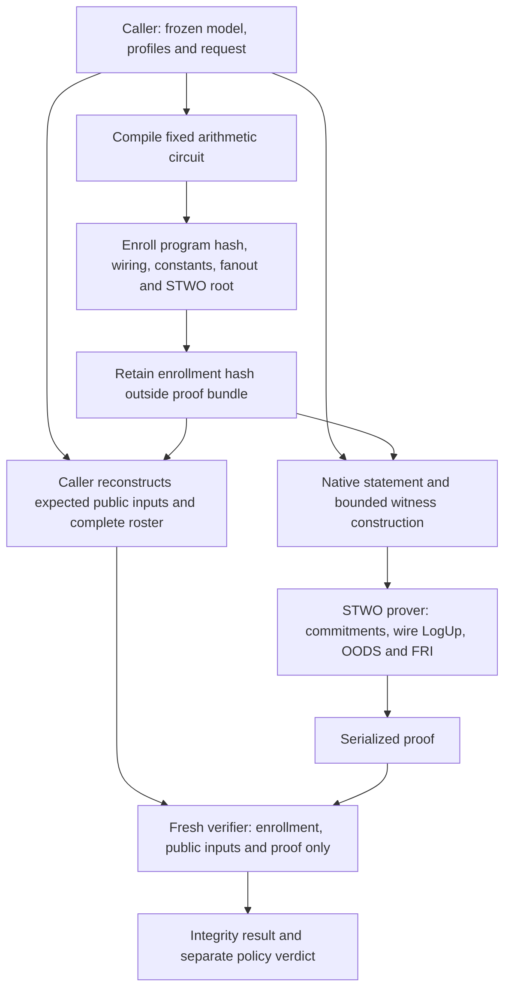
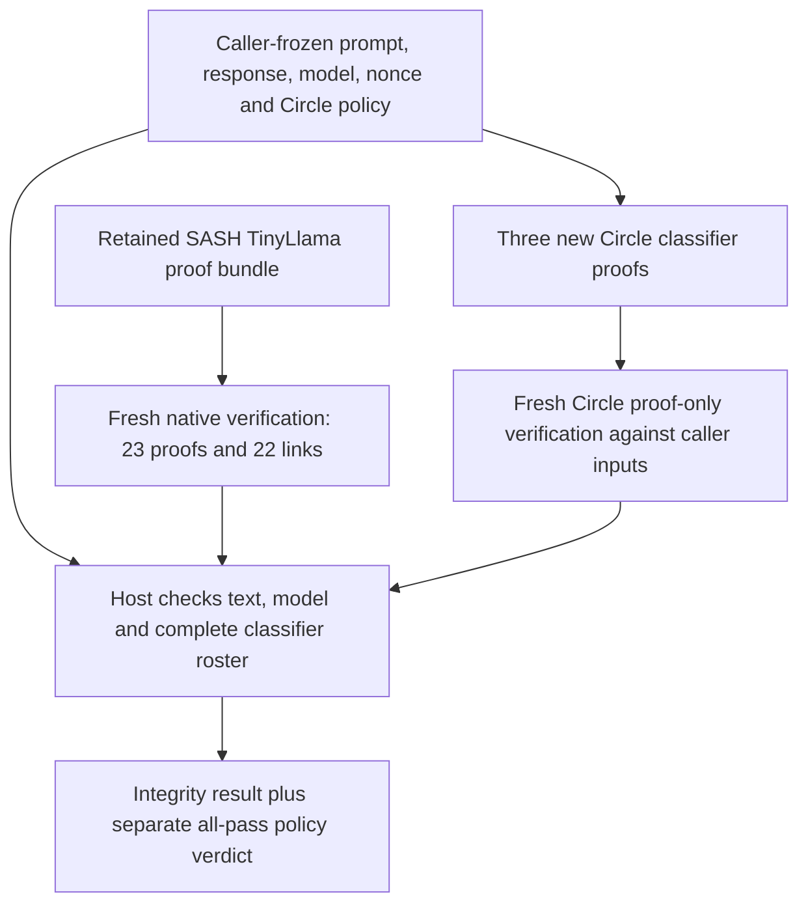

# Circle STARK classifier proofs — the default

The separate [A100 classifier GPU benchmark](CLASSIFIER-GPU-BENCHMARK.md) passes
54 proofs under the unchanged stock verifier. Median nine-proof command sums
are 92.41 s CPU / 22.22 s CUDA across three pairs. The optional CUDA candidate
does not change the stock Mac default or historical CPU comparisons.

The new backend produces real, serialized STWO proofs for the existing literal
rule, four-hidden-unit integer MLP and contextual byte CNN. A fresh verifier
process checks each proof using enrollment and public inputs retained by the
caller. It does not receive the witness, model checkpoint or native execution
trace.

The [acceptance record](../research/evidence/circle-classifiers-acceptance-2026-10-27.json)
contains nine passing proofs: all three classifiers on each of the three frozen
requests. The verdicts match the native/gnark workflow. All 63 direct public-input
mutations, 18 cross-request substitutions and three invalid rosters reject.
A second acceptance run confirms those counts. Full-length conformance adds
three passing proofs and rejects 21 invalid witnesses in real STWO constraints;
an omitted dense edge rejects at program-pin admission. These are exploratory
acceptance results. The subsequent [matched CPU comparison](CLASSIFIER-BENCHMARK.md)
passes all 144 measured proofs plus the composed LLM request. Its warm nine-proof
workflow medians are 298.88 s for Circle and 781.25 s for gnark, with substantial
memory/artifact trade-offs and different security profiles. Both research paths
are retained; Circle is now the default for `make e2e` under
[decision 0085](decisions/0085-circle-default.md). Default selection does not
change the backend’s unqualified research status.

## Run the acceptance workflow

Use an Apple Silicon Mac, CPython 3.12.12, uv 0.9.18 and Rust's
`nightly-2025-07-14` toolchain. The default workflow trains the frozen models and exports their integer graphs;
it never generates Groth16 setup or proofs. Allow a 30-GiB sampled worker-memory
stop, up to 4 GiB of proof outputs, and at least 12 GiB free plus build caches.
The proof driver stops below 8 GiB free. Run:

```bash
make e2e
```

To reuse only the exact hash-pinned quantizations from a caller-owned run:

```bash
make e2e CLASSIFIER_RUN=runs/e2e-circle-<your-run>
```

The target builds the locked prover and a verifier without the prover feature,
pins both binaries, enrolls all three fixed circuits, constructs the three caller
requests, generates nine new proofs, and runs fresh verification and rejection
checks. It prints a new evidence directory. Success requires `status: passed`,
`fresh_proofs: 9`, `fresh_proof_only_verifications: 9`, 63 direct rejections,
18 cross-request rejections and three invalid-roster rejections. A block verdict
can be a successful proof result. No paid compute is launched.

The directory retains protocol/source/binary hashes, caller enrollment and its
pin written before proving, request/bundle files, worker logs, proof files,
resource samples and `result.json`. Failures retain `failure.json` and their
partial outputs. Inspect the named worker's `stderr.txt` first; do not replace
a failed directory or adopt an enrollment hash supplied only by a prover.

The [recorded Make reproduction](../research/evidence/circle-make-e2e-2026-10-27.json)
executes the earlier explicit-backend entrypoint, builds both locked targets and passes all nine
proofs and rejection checks. Its driver takes 97.81 s excluding compilation;
this Mac command check is separate from the matched HF measurements.

## Replay the baseline and check constraint failures

The following legacy comparison commands require preparation from
`make e2e BACKEND=gnark`; they are not prerequisites for the default. Replay its frozen native contract and freshly
verify its nine retained gnark proofs:

```bash
uv run --locked --python 3.12.12 python scripts/check_classifier_comparison.py \
  --classifier-run runs/e2e-<your-run> \
  --expected-enrollment <your-saved-enrollment-sha256>
```

The command prints a new evidence directory. Passing output records nine fresh
cryptographic checks, zero newly generated proofs, 10 input boundaries, 20 scalar
cases, 18 cross-request rejections and three roster rejections. Original proof
generation belongs to the preceding `make e2e BACKEND=gnark`; this replay is not a benchmark.

After the Circle acceptance workflow, retain its `caller-pin.json` hash while
the enrollment is under your control. Keep the binaries built by
`make e2e BACKEND=circle`; the conformance command checks their hashes against
that run's protocol before using them. Replace the paths and both saved pins:

```bash
uv run --locked --python 3.12.12 python scripts/check_circle_classifiers.py \
  --classifier-run runs/e2e-<your-run> \
  --expected-enrollment <your-saved-enrollment-sha256> \
  --circle-run runs/circle-e2e-<your-run> \
  --expected-circle-enrollment <your-saved-circle-enrollment-sha256> \
  --prover research/probes/circle/target/release/circle-prove \
  --verifier research/probes/circle/target/release/circle-verify \
  --output runs/circle-conformance-<new-run>
```

Success requires three new maximum-length proofs and fresh verifications,
21 invalid witnesses rejected by STWO's constraint check, and one omitted dense
edge rejected against the enrolled program. Ten input boundaries include empty,
96/97-byte and multibyte UTF-8 cases; each admitted case checks all three graphs
against native arithmetic. The output directory must be new. Failures retain
their logs and partial outputs; parser rejection cannot substitute for the
required invalid-witness constraint failures. These are conformance checks,
separate from the repeated measurements below.

Separate arithmetic fixtures exercise scores one below, equal to and one above
both frozen thresholds. Equality blocks; changed public threshold limbs and
verdicts fail the gate equations. These fixtures test the arithmetic boundary,
not whether the trained models can attain each score.

## What the proof establishes

Each circuit covers the complete input up to 96 UTF-8 bytes. Oversized inputs
reject. No floating-point inference, truncated prefix, alternative hash or native
replay is substituted for a proof.

| Part | Constrained computation |
|---|---|
| Input | 96 bounded byte slots, prefix mask, exact count and zero padding |
| Commitment | Canonical CBOR integer/array encoding; exact salted SHA-256 `hallmark/v1/input` preimage; correct variable-length SHA padding |
| Rule | Literal `BAD` at every possible position, including across four-byte chunk boundaries; exact chunk count and verdict |
| MLP | All 256 byte counts; four exact affine accumulators; signed ties-to-even rescaling; ReLU; output affine/rescaling; strict threshold zero |
| CNN | Byte embedding; masks; all 96 width-24 causal windows and 32 channels; signed rescaling; ReLU; masked maximum; head; strict threshold −3733 |

The CNN computes inactive positions too, then excludes them from pooling.
Signed 32-bit head accumulators use two 16-bit limbs and constrained carries.
A field equality alone would allow integer aliases modulo M31. Narrow signed
values use bounded decompositions; SHA's 32-bit words use bounded limbs.
Equality with either classifier threshold blocks.

The logical public statement has the same 100 fields as the
[gnark statement](PROOFS.md): context, classifier and input digests, unit/chunk
counts, biased signed threshold and verdict. Its M31 transport splits the
32-bit threshold into two 16-bit limbs and adds public zero/one wires. It does
not reduce 32-bit transport values modulo M31.

## MLP decision limitation

The frozen seed-17 MLP always returns allow in the admitted 96-byte domain.
Its quantization is unchanged. An independent interval relaxation over all
nonnegative byte-count vectors with sum at most 96 gives hidden ReLU ranges
[0,1], [0,14], [221,320], [0,14], output accumulator [−22399,−9351], and
ties-to-even score [−5600,−2338]. The score remains strictly below threshold 0.
This includes all valid UTF-8 inputs, not only the benchmark examples.

The [numeric certificate](../research/evidence/mlp-domain-bound-2026-10-27.json)
pins the quantization, canonical model, analysis source and native program.
[The checker](../scripts/check_classifier_bounds.py) reproduces it using exact
rational rounding; four tests include exhaustive small-domain cases. It is a
conservative bound, not a tight optimization result, test-set evaluation or
cryptographic proof. Do not fabricate an MLP block case or retune the frozen
threshold. The combined workflow has actual allow/block controls through the
rule and CNN. [Follow-up #131](https://github.com/AbdelStark/hallmark/issues/131)
keeps new model training separate from this backend comparison.

The STARK still constrains every MLP operation and its input commitment. A
constant decision over this domain does not imply constant intermediate values
or establish classifier quality.

## What the caller checks

The caller admits the frozen exports, creates the expected request, enrolls the
compiled program and preprocessing root **before proving**, and retains their
hash outside the proof bundle. It reconstructs the native public statement and
requires exactly one proof for each enrolled classifier. The current caller
still reruns native inference; its cost belongs in the complete-workflow timing.

Context construction, policy identities, classifier identities, salt derivation,
UTF-8 admission and complete roster checks are host checks. They are not a proof
that a transcript was authentically captured. Backend/key/setup fields change
classifier identities, policy/context hashes and derived salts. Comparisons
match the exact opening contents and frozen arithmetic, and record both identity
chains; the backend-specific public statements need not be byte-identical.



## Code and dependency ownership

This backend depends directly on **STWO 2.2.0**, pinned in its own
[Cargo lockfile](../research/probes/circle/Cargo.lock), with
`nightly-2025-07-14`. It does not invoke SASH's Llama CLI or modify the existing
LLM backend. The LLM continues to use the separately pinned SASH/Nitroo fork.
Their APIs, roots and proof encodings differ.

| Owner | Files and responsibility |
|---|---|
| Upstream STWO | Circle FFT, polynomial commitments, Blake2s Merkle/transcript, OODS, FRI and constraint framework; locked registry dependencies |
| Hallmark Rust adapter | [Gate AIR and verifier](../research/probes/circle/src/lib.rs), [prover](../research/probes/circle/src/prover.rs), separate CLI binaries |
| Hallmark circuit compiler | [Boolean/SHA circuit](../scripts/circle_circuit.py), [signed arithmetic](../scripts/circle_integer.py), [classifier graphs](../scripts/circle_classifiers.py) |
| Hallmark caller | [Enrollment and bundle binding](../scripts/circle_backend.py), [acceptance workflow](../scripts/run_circle_classifiers.py) |

The gate AIR/LogUp code adapts the upstream PLONK example's API patterns.
[NOTICE](../research/probes/circle/NOTICE.upstream) and the Apache-2.0 licence
are retained. The caller fixes wiring, constants and producer fanout in
preprocessing; they are not prover-chosen witness multiplicities. An explicit
product column and unbatched wire lookups keep all constraints quadratic.
Every wire reference is checked against the enrolled producer through LogUp.
This executes a fixed circuit; there is no instruction set or general-purpose VM.

## How the gate proof binds the graph

Every fixed gate row carries three wire values `a`, `b`, `c` and a product
column `t`. Its enrolled selectors enforce:

```text
t = a * b
q_m * t + q_a * a + q_b * b + q_k = q_out * c
(active - write) * c = 0
```

Arithmetic rows write `c`; assertion rows require their expression and output
to be zero. Private-input rows deliberately leave `c` free until the classifier,
SHA and range constraints consume it. Padding rows require zero wire values.
The product column keeps the selector equation quadratic; multiplying a varying
selector directly by `a*b` would make it cubic.

A gate equation alone cannot require two rows to use the same value for a shared
wire. The fixed preprocessing therefore also commits each wire ID and its exact
consumer count. After the base trace is committed, transcript challenges define
a tuple combiner `L(id, value)`. Three unbatched LogUp columns enforce the balance:

```text
sum_rows(active / L(id_a,a) + active / L(id_b,b) - fanout_c / L(id_c,c))
    = sum_public(public_multiplicity / L(public_id, caller_value))
```

The verifier computes the right-hand side from caller values and the enrolled
multiplicities. It accepts no free prover-chosen boundary sum. The independently
enrolled preprocessing root binds wiring, constants, selectors and fanout before
proving. This checks a fixed arithmetic graph; there is no instruction set,
program counter or general-purpose VM execution trace. The concrete parameters
and unqualified security boundary are below.

## Parameters and limits

The fixed profile uses M31, QM31 lookup challenges, Blake2s commitments/transcript,
80 FRI queries, blowup factor 16, folding step one, final-layer log degree five
and 16 proof-of-work bits. Tree domains share `log_rows + 4`; quadratic constraint
evaluation uses `log_rows + 1`.

These are concrete parameters, not a claim of equal security to BLS12-381
Groth16 or a production security level. Statistical lookup error depends on
the extension field and relation size; FRI, Fiat–Shamir and hash assumptions
also apply. The prover/verifier share STWO and the same AIR implementation.
Fresh-process verification is not an independent implementation or audit.

There is no witness blinding, hardware attestation or production qualification.
The tests establish arithmetic and integration behavior, not classifier safety
quality. The original synthetic data, model exports, thresholds and historical
timings are unchanged.

## Matched comparison and timing scope

The [completed report](CLASSIFIER-BENCHMARK.md) publishes all raw samples,
median/range/IQR, stage timings, native baselines, keys/parameters, storage,
failures and the retain-both recommendation. [Numeric evidence](../research/evidence/circle-classifiers-benchmark-2026-10-27.json)
also records fresh Mac verification of all 144 proofs, owner-archive checks and
the composed-request result. Mac acceptance timings remain a separate workload.

The [frozen comparison plan](../configs/circle-classifiers/plan.json) specifies
three fresh and five warm complete workflows per backend. Each workflow contains
nine proofs, yielding eight measurements for every request/classifier pair.
Fresh includes compilation and per-classifier setup/preprocessing; warm makes
new proofs and launches fresh verifiers using admitted preparation. OS caches
are not flushed. Report shared costs and their amortization denominator.

Warm reuses admitted program/enrollment files and Groth16 setup keys. The
stateless Circle CLI still reconstructs twiddles and preprocessing commitments
for every new proof; its raw `preprocessing_and_model_commitment` stage records
that repeated cost. Warm does not mean those computations are free or cached
in memory. Fixed weights share the graph/preprocessing commitment; a separate
weight-commitment time is `null` with an explicit reason, rather than zero.

Stage boundaries also differ: gnark's constraint solving runs inside
`groth16.Prove`, while Circle's host witness timing includes rebuilding the gate
graph, checking native parity and encoding the witness. Compare complete prover
commands together with host witness work, and complete workflow wall time.
Compilation is shared across nine proofs in a fresh workflow; each classifier's
setup is shared across its three requests. Native-only timing excludes request
admission and commitments. Native-plus-binding and caller checks include the
current native recomputation. The full workflow also includes the separate
native baseline observations; it is not a minimal serving-latency measurement.

Report native inference and native plus binding; program construction, setup,
commitments, witness generation, proving, serialization, proof-only verification
and total wall time; proof/key/parameter bytes; sampled process-tree RSS; failures
and all source/environment/input/output hashes. Report successful/attempted counts,
median, range and IQR. An isolated proving time is not an end-to-end cost or a
backend recommendation.

See [decision 0083](decisions/0083-circle-classifier-comparison.md) and the
[engine review](../research/circle-classifier-engine-review.md) for the frozen
baseline, budgets, provenance and rejected implementation paths.


## Matched HF CPU campaign

The separate [HF profile](../configs/circle-classifiers/hf-plan.json) keeps the
same cases, model exports, arithmetic, repetitions and four proving threads.
Both backends run inside one `cpu-upgrade` job: Linux x86-64, 8 vCPU, 32 GB RAM,
a 28 GiB process-tree stop and 8 GiB free-storage stop. It is a different
experiment from the Mac acceptance runs. Never combine their timings into a
matched speedup. [Decision 0084](decisions/0084-hf-classifier-comparison.md)
records the finite budget, pinned user-local tools, input-copy accounting,
failed fixtures and retention rules. No system packages or provider credentials
are installed in proof workers.

The source and protocol must be committed before launch. With the separately
locked `llm` and `train` extras installed, run the fixture first:

```bash
uv run --locked --extra llm --extra train python scripts/run_classifier_benchmark_hf.py \
  --stage fixture \
  --classifier-run runs/e2e-<your-run> \
  --expected-enrollment <your-original-caller-pin> \
  --circle-reference runs/<your-admitted-circle-acceptance> \
  --output runs/<new-hf-fixture>
```

Use the same arguments with `--stage benchmark`, a new output directory and
`--fixture-receipt runs/<new-hf-fixture>/fixture/validated-result.json`. The
controller checks the current quote, admits only the finite configured budget,
uploads public source/fixtures, and launches one attempt. It retains every
terminal output before deleting its owned temporary bucket. A failed run does
not supply a benchmark sample. Fix the candidate and freeze a new experiment
identity before another paid attempt. No top-up, scheduler or automatic paid
retry is provided.

The full matrix creates 144 new proofs and 144 fresh verifications: three fresh
and five warm workflows, each with all nine request/classifier pairs, for both
backends. Then it creates three additional Circle proofs for a caller-frozen
TinyLlama request. Those three are excluded from benchmark statistics. The
caller freezes their enrollment and all expected public fields before upload;
Linux preprocessing must match the retained Mac roots byte for byte.

## LLM request composition

The default entrypoint is now `make e2e-composed`: it prepares native classifiers
without Groth16 setup and joins three new Circle proofs to freshly checked SASH
proofs. See the [current run guide](COMPOSED-DEMO.md). The lower-level checker and
11.13-second observation below belong to the earlier retained campaign, excluding
native verifier compilation and fresh classifier proving.



The [composition checker](../scripts/check_circle_composed.py) takes the
retained campaign, the owner's pre-upload request and its external hash,
original classifier preparation/enrollment, and independently pinned Mac
Circle/LLM verifier executables. It rechecks both proof systems in fresh
processes, checks all 300 caller public fields and rejects changed text, model,
nonce, interaction, policy, salt, classifier identities, enrollment, request
and roster. Its `--help` lists exact arguments. The retained native executable
must match the existing 55-file verifier identity and compiled shape enrollment;
no proof acceptance flag from the job is sufficient.

The host join is not recursive aggregation. The retained LLM proof is replayable
and does not bind the caller's new nonce; the classifier context does. This is
a fresh verification of an existing inference proof, not fresh LLM proving.
The synthetic CNN may block the ordinary question even when every proof is
valid. Proof integrity is separate from classifier usefulness or policy release.

The recorded check verifies three Circle proofs and all 23 retained LLM proofs,
checks 22 residual links and rejects 16 changed-binding/coverage cases in
11.13 s including hashes and host work. Verdicts are `[1,1,0]`: integrity passes,
policy release is false. [Complete evidence and boundaries](CLASSIFIER-BENCHMARK.md#independent-retained-input-checks-and-llm-composition).


## Audit the retained statistics

The controller's local admission record pins the source commit. Its retention
record and output receipt pin the complete archive. After a successful campaign,
recompute the report without proving again:

```bash
uv run --locked --extra train python scripts/report_classifier_benchmark.py \
  --archive runs/<hf-campaign>/benchmark/retained/outputs.tar.gz \
  --expected-archive <your-retained-archive-sha256> \
  --expected-commit <your-admitted-source-commit> \
  --output runs/<new-byte-audit>
```

This streams and hashes the inventory, checks captured source/environment/input
pins and all 144 serialized proof hashes, and recomputes every reported median,
range and IQR from the 16 raw samples. It also extracts the small Circle enrollment
and composition bundle needed by the fresh local checker. It is a byte/statistics
audit, not another cryptographic verification or a security review.

Before composing, check every retained benchmark proof locally:

```bash
uv run --locked --extra train python scripts/check_classifier_archive.py \
  --audit-run runs/<new-byte-audit> \
  --expected-commit <your-admitted-source-commit> \
  --classifier-run runs/e2e-<your-run> \
  --expected-enrollment <your-original-caller-pin> \
  --expected-circle-enrollment <your-pre-upload-circle-enrollment-pin> \
  --circle-verifier <your-admitted-Mac-circle-verify> \
  --expected-verifier <your-retained-circle-binary-sha256> \
  --output runs/<new-local-proof-check>
```

The byte audit extracts the public proof-only subset, excluding witnesses,
checkpoints, model exports and proving keys. The local checker reconstructs all
caller public inputs, requires the independent Mac Circle enrollment, checks
gnark's captured pre-proof circuit/key records, and verifies 72 Circle and 72
Groth16 proofs. Groth16 still trusts the owner's recorded setup; this adds no
ceremony or setup-attestation claim. Circle uses one fresh process per proof;
local py-ecc checks three classifier proofs per fresh process, as in the
original separate-arithmetic checker. The primary Linux measurements retain one
fresh verifier per proof. These additional Mac checks are excluded from the
matched timing statistics and do not reuse the provider's pass flag.

Then freshly check the retained composition, supplying the caller's request file
from before upload and independently retained executable hashes:

```bash
uv run --locked --extra train python scripts/check_circle_composed.py \
  --classifier-run runs/e2e-<your-run> \
  --expected-enrollment <your-original-caller-pin> \
  --owner-request runs/<hf-campaign>/composed-request.json \
  --expected-request <your-pre-upload-request-sha256> \
  --campaign runs/<new-byte-audit>/campaign \
  --circle-verifier <your-admitted-Mac-circle-verify> \
  --expected-circle-verifier <your-retained-circle-binary-sha256> \
  --llm-verifier <your-admitted-Mac-zk-prover> \
  --expected-llm-verifier <your-retained-native-binary-sha256> \
  --llm-proof-directory <your-retained-69-file-LLM-proof-directory> \
  --output runs/<new-composition-check>
```

Use your own retained pins; copying a digest from the untrusted proof bundle does
not independently enroll it. The native executable must be the existing compiled
shape/root verifier for this case. This check reuses its admitted build, not its
old pass flag. It never supplies a checkpoint or witness to either proof verifier.
