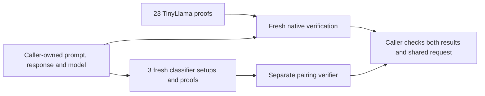

# A proved response and three classifier decisions

The composed demo checks two computations over the same opened request:

1. Quantized TinyLlama computes “The capital of France is Paris.” from the pinned
   prompt “Name the capital of France in one short sentence.”
2. The literal rule, trained byte MLP and trained byte CNN compute their verdicts
   on that exact prompt, with the response and model bound into the shared context.

It uses the existing specialized SASH and Groth16 relations. There is no
general-purpose zkVM or hardware attestation.



## Run the workflow

Use the [LLM demo prerequisites](LLM-PROOF.md#run-it), the pinned Rust toolchain
from [native verification](LLM-PROOF.md#verify-retained-proofs-on-your-mac), and at
least **32 GiB free storage**. From the checkout:

```sh
make e2e-composed
```

This runs the existing LLM preparation/proving pipeline, freshly verifies its
proofs locally, prepares the existing trained classifier demo, then makes three
new classifier setups and proofs for the LLM request. The original classifier
demo remains a control. Its setup/proving work is additional to the three new
proofs. Allow the time and memory required by both standalone demos.

Fresh LLM proving starts paid HF CPU jobs under the existing **$2.10 maximum
timeout-based cost ceiling**. It requires existing prepaid credits and `HF_TOKEN`;
it does not add funds. The classifier stages and native verification run locally.

If you already have completed runs, reuse their preparation:

```sh
make e2e-composed \
  LLM_RUN=/path/to/llm-e2e-run \
  CLASSIFIER_RUN=/path/to/classifier-e2e-run
```

With **both** paths supplied, the workflow starts no cloud job, downloads no
checkpoint and needs no HF credential. Locked Python/Rust dependencies may need
installation. The paths are caller-owned preparation, not an untrusted prover's
executable environment: the classifier binary and quantizations have pinned
hashes, and its separate Python verifier environment must be trusted. No saved
`passed` result substitutes for fresh verification.

The LLM's retained 23 proofs are freshly verified twice, including all 36 mutation
rejections. The three classifier keys and proofs are always new. The separate
pairing implementation verifies each proof, and its 399-case corpus includes
honest controls, changed public fields, keys, encodings and malformed proofs.
Eleven additional composition checks change the opened text/context or classifier
evidence. Failures return nonzero and preserve their logs.

## Read the outcome

The command prints a fresh `runs/composed-*` directory. Its successful
`result.json` separates proof integrity from the classifier policy:

```json
{
  "status": "passed",
  "llm_proofs_verified": 23,
  "classifier_proofs_verified": 3,
  "classifier_verdicts": [1, 1, 0],
  "policy_release": false,
  "classifier_scope": "prompt",
  "safety_quality_claim": false,
  "qualified_backend": false,
  "hardware_claim": "not-accepted",
  "hiding_claim": false
}
```

**Integrity passes while this synthetic policy blocks.** The CNN was trained on
a narrow authored action/quotation task. It blocks this ordinary France prompt;
its weights and threshold remain frozen. A proof faithfully establishes that
decision, not that it is a useful policy. The classifiers do not classify the
answer's safety or factuality.

The verdict order is rule, MLP, CNN; `1` means pass and `0` means block.

The directory retains source pins, fresh classifier enrollment and setup keys,
the exact CBOR request opening/expectations, classifier proofs, separate-verifier
results, mutation outcomes and costs. The result points to the fresh native LLM
verification directory and hashes its result. Keep these local artifacts; the
command does not publish them.

## What connects the proofs?

The caller owns the exact prompt/response strings, frozen LLM case, model identity
and classifier policy. It checks that the transcript matches the case whose token
sequence was enrolled and proved. The classifier proofs bind the transcript's
context, input digest and classifier identities. Changing the response preserves
the prompt's classifier input but changes its context, so the original classifier
proofs cannot be accepted for the new request.

The join is performed by the caller; it is not a recursive aggregate proof or a
hardware receipt. Tokenization and detokenization belong to the separately pinned
LLM case, not a new tokenizer circuit. The model identity is an explicit research
descriptor, not operational v1 model enrollment. Fresh request IDs do not show
when the deterministic LLM computation occurred. Generation precedes classifier
evaluation in this offline demo; no protected release path is claimed.

The [classifier proof explanation](PROOFS.md), [LLM proof explanation](LLM-PROOF.md)
and [composition decision](decisions/0073-compose-proved-llm-and-classifier-request.md)
state the component assumptions. Backend/setup custody, independent security
review, operational enrollment, policy quality and genuine hardware evidence
remain separate gates.

## Recorded reproduction

Two fresh local campaigns with retained preparation passed on an Apple M4 Max:

| Campaign | Composed controller | Native LLM build/check suite | Classifier setup/proof/check suite |
|---|---:|---:|---:|
| First | 856.00 s | 206.46 s | 649.36 s |
| Confirmatory Make invocation | 850.12 s | 205.10 s | 644.62 s |

Each campaign produced three new classifier setups and proofs. All three keys
differ between campaigns; both model and circuit inventories match. Each rejected
36 LLM mutations and eleven composition mutations, and matched 399 classifier
arithmetic outcomes. The final openings reconstruct the exact public-input jobs
given to the separate pairing verifier. New cloud jobs and spend were zero.

These are diagnostic observations, with other host activity uncontrolled. The
full fresh-preparation mode was not repeated for this study; its existing stages
have their own reproduction evidence. [Raw results, source/input hashes and limits](../research/evidence/composed-request-2026-10-25.json)
distinguish retained LLM proof bytes from freshly generated classifier proofs.
