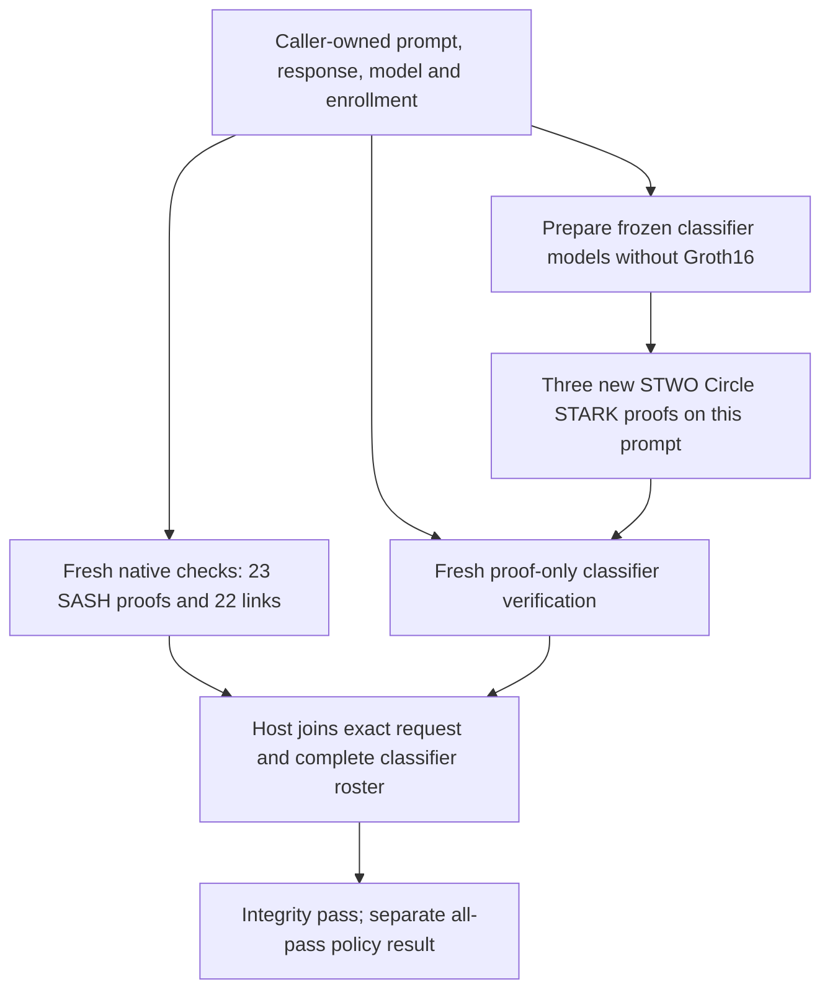

# A proved response and three Circle STARK classifier decisions

Circle STARK is the default throughout this workflow: **SASH** proves the fixed
quantized TinyLlama response; **direct STWO** proves the rule, byte MLP and byte
CNN decisions on its exact prompt. No Groth16 setup, general-purpose zkVM or
hardware attestation is involved.

The request is fixed: “Name the capital of France in one short sentence.” →
“The capital of France is Paris.” The complete answer through EOS has **23 LLM
proof segments and 22 residual links**. The controller produces **three new
classifier proofs**, one per classifier. It does not run the standalone nine-proof
control first. Classifiers inspect the **prompt**; the response and LLM model
identity are bound into their shared context. Composition is a host check, not a
recursive aggregate proof.



## Run the workflow

Use the [LLM prerequisites](LLM-PROOF.md#run-it), the
[classifier prerequisites](DEMO.md#prerequisites), and **32 GiB free storage**
for fresh LLM preparation:

```sh
make e2e-composed
```

Fresh LLM proving starts the existing bounded paid HF CPU jobs with the CLI's
**$2.10 timeout-based ceiling**, using prepaid credits and `HF_TOKEN`. Classifier
preparation and proofs run locally. There is no new payment or account setup.

For a local run with retained LLM proofs:

```sh
make e2e-composed \
  LLM_RUN=/path/to/llm-e2e-run \
  CLASSIFIER_RUN=/path/to/classifier-e2e-run
```

Retained LLM composition needs **12 GiB free plus build-cache headroom**. It
starts no cloud job and downloads no checkpoint. `CLASSIFIER_RUN` is optional:
it reuses only the two exact frozen model quantizations; omit it to retrain.
Dependencies may require initial network access. Proofs are verified afresh;
a saved success flag never substitutes for a cryptographic check.

The controller validates LLM parameter authority before preparation and after
composition; the native LLM driver runs two honest verifications and all 36
mutation checks. The classifier driver enrolls all three fixed programs before
proving, freshly verifies each proof, rejects 21 changed public statements and
three invalid rosters, and checks native/circuit trace parity. The outer join
runs three more proof-only verifications and **16 distinct binding/roster checks**.

The source is [run_circle_composed.py](../scripts/run_circle_composed.py), reusing
[run_circle_e2e.py](../scripts/run_circle_e2e.py) and the original pinned SASH
verification driver. The 55-file LLM verifier identity is unchanged. The
[architecture guide](ARCHITECTURE.md) distinguishes dependencies and patches.

## Signed LLM parameters

To require signed LLM parameter authorization, obtain the signer's public key
through your own authenticated channel and provide both inputs:

```sh
LLM_ENROLLMENT=/path/to/enrollment.cbor \
LLM_TRUST_KEY="$SIGNER_PUBLIC_KEY_HEX" \
make e2e-composed \
  LLM_RUN=/path/to/llm-e2e-run \
  CLASSIFIER_RUN=/path/to/classifier-e2e-run
```

The [native enrollment guide](LLM-PROOF.md#verify-a-signed-parameter-enrollment)
defines the signed record, source inventory and signing API. Its public key is
64 lowercase hex characters, supplied separately from the record and proofs.
Omit the retained-run arguments to prepare both components afresh.

Before any fresh preparation, the controller checks the signature, exact LLM
case/verifier identity and validity interval. It snapshots the signed record,
passes that copy to fresh native verification, checks the reported authority and
rechecks validity after classifier proving. Invalid or incomplete authorization
fails; expiry during the classifier stage cannot publish a composed success.
Choose an interval covering the whole workflow. Any bound source change needs
a new authorization.

The result's `parameter_authority` reports `ed25519`, the signed-record and public-key
SHA-256 fingerprints, validity interval and final check time. With neither input,
it explicitly reports `{"kind":"checkout-case"}`. Script callers can use the
equivalent `--enrollment FILE --trusted-key HEX` arguments.

This authorization covers the LLM case and verifier sources. Classifier policy
and preprocessing enrollment remain separate; no persistent revocation/rollback service,
operational signer custody or independent security qualification is supplied.
See [decision 0075](decisions/0075-signed-composed-enrollment.md).

## Read the outcome

A successful `runs/composed-circle-*/result.json` includes:

```json
{
  "schema_id": "hallmark.circle-composed-request-result/1",
  "status": "passed",
  "backend": "circle",
  "llm_proofs_verified": 23,
  "residual_links": 22,
  "classifier_proofs_verified": 3,
  "classifier_verdicts": [1, 1, 0],
  "policy_release": false,
  "classifier_scope": "prompt",
  "host_join": true,
  "recursion": false,
  "parameter_authority": {"kind": "checkout-case"},
  "qualified_backend": false,
  "hardware_claim": "not-accepted",
  "hiding_claim": false
}
```

**Integrity passes while the synthetic policy blocks.** Verdict order is rule,
MLP, CNN; 1 means pass. The narrow CNN blocks this ordinary France prompt. The
frozen MLP always allows in the admitted domain. These are faithful computation
proofs, not evidence of useful policy quality or response safety/factuality.

The directory retains source/authority records, the fresh native LLM result hash,
the new classifier result hash, and three fresh proof-only join checks. Its
classifier directory retains enrollment, exact CBOR requests, proof bundles,
rejection records and resource samples. Failures preserve `failure.json` and
partial outputs in new directories. Nothing is published by the command.

## What connects the proofs?

The caller checks the exact opened strings against the enrolled LLM token case
and model, then reconstructs the classifier public statements under its own
policy/enrollment. Changing the response preserves the classifier's prompt input
but changes request context; the old proofs cannot be reused for that request.
Exact roster checks reject missing, duplicated, reordered or substituted proofs.

Tokenization/detokenization remain pinned host checks. Initial model/shape
provisioning and classifier enrollment remain caller trust boundaries. A model
identity does not prove training history or authentic context capture. There is
no protected release path, private witness claim, hardware receipt or independent
security qualification. [Classifier statement](PROOFS.md),
[LLM statement](LLM-PROOF.md#the-statement), [current default decision](decisions/0085-circle-default.md).

## Recorded Circle default acceptance

The actual default retained-input Make command completed in **266.29 s**,
including a fresh native LLM verifier build and its complete mutation suite.
All 23 LLM proofs, 22 links, three newly generated classifier proofs and three
outer-join proof checks pass; all 16 binding checks reject. No paid job starts.
This is one Mac acceptance observation with populated dependency caches, not a
latency distribution. [Numeric receipt and source pins](../research/evidence/circle-default-2026-10-28.json).

## Explicit gnark comparison

```sh
make e2e-composed BACKEND=gnark \
  LLM_RUN=/path/to/llm-e2e-run \
  CLASSIFIER_RUN=/path/to/gnark-e2e-run
```

This preserves the original SASH-plus-Groth16 controller and result schema.
Its retained classifier preparation must come from `make e2e BACKEND=gnark`;
it uses fresh circuit-specific local setups and separate py-ecc verification.
The following recorded campaigns belong to that historical mixed-backend path.
Their timings, keys, 399/405-case arithmetic checks and eleven binding checks
are **not** measurements or check counts for today's Circle default.

## Historical gnark composition: fresh preparation

On 2026-10-25, the actual `make e2e-composed` command passed with neither
`LLM_RUN` nor `CLASSIFIER_RUN`. It generated new LLM witnesses/proofs, trained and
exported the classifiers, ran the control campaign and produced three new proofs
for the LLM request.

| Stage | Measured wall time |
|---|---:|
| Complete Make command | 4,010.05 s (66 min 50 s) |
| LLM preparation, build, proving and original verification | 1,963.89 s |
| Native build and 38-case verification suite | 222.25 s |
| Fresh classifier preparation and nine-proof control | 1,148.42 s |
| Three composed classifier proofs and checks | 672.15 s |

The original verifier accepted both honest checks and rejected all 14 mutations.
The native verifier accepted two honest checks and rejected all 36 mutations.
The classifier control verified nine proofs, rejected all 18 cross-request
substitutions and matched all 405 arithmetic outcomes. The composed campaign
verified three proofs, rejected eleven binding mutations and matched all 399
arithmetic outcomes. Verdicts were `[1, 1, 0]`; integrity passed and the synthetic
policy blocked. The final opening reconstructs exactly the public-input jobs
given to the separate pairing verifier.

All 69 LLM proof/statement/claim files match the earlier accepted bundle and all
five fresh LLM campaigns byte for byte. Both selected model exports and all three
circuit identities match the baseline. The new classifier setup keys differ from
the previously recorded campaigns.

The successful command added 12.31 GiB of allocated storage and peaked at
13.52 GiB summed local descendant RSS, sampled once per second. Its cloud compute
bound was $0.31. The full study's bound was $1.55, including earlier attempts;
these are conservative compute bounds, not invoices. All fifteen cloud jobs are
completed and every temporary bucket is independently confirmed absent.

Three failed full commands and one deliberate interruption preceded the complete
success. Checkpoint downloading raised the inherited file-descriptor limit, which
stalled nested sandbox execution. Go build IDs and included-assembly paths then
made the classifier binary depend on its build location. Worker child limits and
cache-correct assembler path normalization resolve those observed integration
failures while preserving explicit binary admission. The
[decision and failure history](decisions/0074-fresh-composed-reproduction.md) and
[raw numeric evidence](../research/evidence/fresh-composed-2026-10-25.json)
retain every attempt, source/input identity and resource amendment.

Dependency/download caches were not cleared. Disposable worker OS-package
inventories are retained; their package resolution is not fully hermetic. These
are diagnostic observations on an Apple M4 Max, with other host activity
uncontrolled, not latency distributions or independent security qualification.

## Historical gnark composition: retained reproduction

Two fresh local campaigns with retained preparation passed on an Apple M4 Max:

| Campaign | Composed controller | Native LLM build/check suite | Classifier setup/proof/check suite |
|---|---:|---:|---:|
| First | 856.00 s | 206.46 s | 649.36 s |
| Confirmatory Make invocation | 850.12 s | 205.10 s | 644.62 s |

Each campaign produced three new classifier setups and proofs. All three keys
differ between campaigns; both model and circuit inventories match. Each rejected
36 LLM mutations and eleven composition mutations, and matched 399 classifier
arithmetic outcomes. The final openings reconstruct the exact public-input jobs
given to the separate pairing verifier. New cloud jobs and spend were zero.

These earlier campaigns measure retained preparation; the fresh default command
is recorded above. They are diagnostic observations with other host activity
uncontrolled. [Raw results, source/input hashes and limits](../research/evidence/composed-request-2026-10-25.json)
distinguish retained LLM proof bytes from freshly generated classifier proofs.
