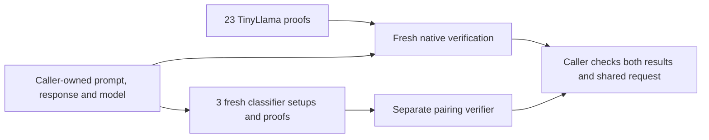

# A proved response and three classifier decisions

The composed demo checks two computations over the same opened request:

1. Quantized TinyLlama computes “The capital of France is Paris.” from the pinned
   prompt “Name the capital of France in one short sentence.”
2. The literal rule, trained byte MLP and trained byte CNN compute their verdicts
   on that exact prompt, with the response and model bound into the shared context.

It uses the existing specialized SASH and Groth16 relations. There is no
general-purpose zkVM or hardware attestation.

The [architecture guide](ARCHITECTURE.md) explains both underlying proof flows,
SASH source/patch ownership and caller trust boundaries. A fresh default run
makes **23 SASH segments and 12 Groth16 proofs**: nine classifier controls plus
three proofs for this LLM request. With both retained preparation paths supplied,
it freshly verifies the 23 segments and makes only the three new classifier
proofs/setups. Classifiers inspect the **prompt**; the response is bound into the
context, not classified. Composition is a host check, not a recursive proof.



## Run the workflow

Use the [LLM demo prerequisites](LLM-PROOF.md#run-it), the pinned Rust toolchain
from [native verification](LLM-PROOF.md#verify-retained-proofs-on-your-mac), and at
least **32 GiB free storage**. From the checkout:

```sh
make e2e-composed
```

This runs the existing LLM preparation/proving pipeline, freshly verifies its
proofs locally, prepares the existing trained classifier demo, then makes three
new classifier setups and proofs for the LLM request. The original classifier
demo remains a control. Its setup/proving work is additional to the three new
proofs. Allow the time and memory required by both standalone demos.

Fresh LLM proving starts paid HF CPU jobs under the existing **$2.10 maximum
timeout-based cost ceiling**. It requires existing prepaid credits and `HF_TOKEN`;
it does not add funds. The classifier stages and native verification run locally.

If you already have completed runs, reuse their preparation:

```sh
make e2e-composed \
  LLM_RUN=/path/to/llm-e2e-run \
  CLASSIFIER_RUN=/path/to/classifier-e2e-run
```

With **both** paths supplied, the workflow starts no cloud job, downloads no
checkpoint and needs no HF credential. Locked Python/Rust dependencies may need
installation. The paths are caller-owned preparation, not an untrusted prover's
executable environment: the classifier binary and quantizations have pinned
hashes, and its separate Python verifier environment must be trusted. No saved
`passed` result substitutes for fresh verification.

The LLM's retained 23 proofs are freshly verified twice, including all 36 mutation
rejections. The three classifier keys and proofs are always new. The separate
pairing implementation verifies each proof, and its 399-case corpus includes
honest controls, changed public fields, keys, encodings and malformed proofs.
Eleven additional composition checks change the opened text/context or classifier
evidence. Failures return nonzero and preserve their logs.

## Signed LLM parameters

To require signed LLM parameter authorization, obtain the signer's public key
through your own authenticated channel and provide both inputs:

```sh
LLM_ENROLLMENT=/path/to/enrollment.cbor \
LLM_TRUST_KEY="$SIGNER_PUBLIC_KEY_HEX" \
make e2e-composed \
  LLM_RUN=/path/to/llm-e2e-run \
  CLASSIFIER_RUN=/path/to/classifier-e2e-run
```

The [native enrollment guide](LLM-PROOF.md#verify-a-signed-parameter-enrollment)
defines the signed record, source inventory and signing API. Its public key is
64 lowercase hex characters, supplied separately from the record and proofs.
Omit the retained-run arguments to prepare both components afresh.

Before any fresh preparation, the controller checks the signature, exact LLM
case/verifier identity and validity interval. It snapshots the signed record,
passes that copy to fresh native verification, checks the reported authority and
rechecks validity after classifier proving. Invalid or incomplete authorization
fails; expiry during the classifier stage cannot publish a composed success.
Choose an interval covering the whole workflow. Any bound source change needs
a new authorization.

The result's `parameter_authority` reports `ed25519`, the signed-record and public-key
SHA-256 fingerprints, validity interval and final check time. With neither input,
it explicitly reports `{"kind":"checkout-case"}`. Script callers can use the
equivalent `--enrollment FILE --trusted-key HEX` arguments.

This authorization covers the LLM case and verifier sources. Classifier policy
and setup enrollment remain separate; no persistent revocation/rollback service,
operational signer custody or independent security qualification is supplied.
See [decision 0075](decisions/0075-signed-composed-enrollment.md).

The recorded signed Make campaign took **866.49 seconds** (14 min 26 s) with
retained preparation, fresh native verification and three fresh classifier proofs.
All 36 LLM mutations, eleven binding rejections and 399 arithmetic outcomes pass.
All five authorization checks refer to the same record/key, including the final
join. Ten actual CLI invalid-input checks reject before preparation. The issuer
is a disposable research key; this is integration evidence, not operational
custody. [Numeric results and retained harness failure](../research/evidence/signed-composed-2026-10-25.json)
preserve the source identities and limitations. New cloud jobs and spend are zero.

## Read the outcome

The command prints a fresh `runs/composed-*` directory. Its successful
`result.json` separates proof integrity from the classifier policy:

```json
{
  "status": "passed",
  "llm_proofs_verified": 23,
  "classifier_proofs_verified": 3,
  "classifier_verdicts": [1, 1, 0],
  "policy_release": false,
  "classifier_scope": "prompt",
  "parameter_authority": {"kind": "checkout-case"},
  "safety_quality_claim": false,
  "qualified_backend": false,
  "hardware_claim": "not-accepted",
  "hiding_claim": false
}
```

**Integrity passes while this synthetic policy blocks.** The CNN was trained on
a narrow authored action/quotation task. It blocks this ordinary France prompt;
its weights and threshold remain frozen. A proof faithfully establishes that
decision, not that it is a useful policy. The classifiers do not classify the
answer's safety or factuality.

The verdict order is rule, MLP, CNN; `1` means pass and `0` means block.

The directory retains source pins, fresh classifier enrollment and setup keys,
the exact CBOR request opening/expectations, classifier proofs, separate-verifier
results, mutation outcomes and costs. The result points to the fresh native LLM
verification directory and hashes its result. Keep these local artifacts; the
command does not publish them.

## What connects the proofs?

The caller owns the exact prompt/response strings, frozen LLM case, model identity
and classifier policy. It checks that the transcript matches the case whose token
sequence was enrolled and proved. The classifier proofs bind the transcript's
context, input digest and classifier identities. Changing the response preserves
the prompt's classifier input but changes its context, so the original classifier
proofs cannot be accepted for the new request.

The join is performed by the caller; it is not a recursive aggregate proof or a
hardware receipt. Tokenization and detokenization belong to the separately pinned
LLM case, not a new tokenizer circuit. The model identity is an explicit research
descriptor, not operational v1 model enrollment. Fresh request IDs do not show
when the deterministic LLM computation occurred. Generation precedes classifier
evaluation in this offline demo; no protected release path is claimed.

The [classifier proof explanation](PROOFS.md), [LLM proof explanation](LLM-PROOF.md)
and [composition decision](decisions/0073-compose-proved-llm-and-classifier-request.md)
state the component assumptions. Backend/setup custody, independent security
review, operational enrollment, policy quality and genuine hardware evidence
remain separate gates.

## Recorded fresh preparation

On 2026-10-25, the actual `make e2e-composed` command passed with neither
`LLM_RUN` nor `CLASSIFIER_RUN`. It generated new LLM witnesses/proofs, trained and
exported the classifiers, ran the control campaign and produced three new proofs
for the LLM request.

| Stage | Measured wall time |
|---|---:|
| Complete Make command | 4,010.05 s (66 min 50 s) |
| LLM preparation, build, proving and original verification | 1,963.89 s |
| Native build and 38-case verification suite | 222.25 s |
| Fresh classifier preparation and nine-proof control | 1,148.42 s |
| Three composed classifier proofs and checks | 672.15 s |

The original verifier accepted both honest checks and rejected all 14 mutations.
The native verifier accepted two honest checks and rejected all 36 mutations.
The classifier control verified nine proofs, rejected all 18 cross-request
substitutions and matched all 405 arithmetic outcomes. The composed campaign
verified three proofs, rejected eleven binding mutations and matched all 399
arithmetic outcomes. Verdicts were `[1, 1, 0]`; integrity passed and the synthetic
policy blocked. The final opening reconstructs exactly the public-input jobs
given to the separate pairing verifier.

All 69 LLM proof/statement/claim files match the earlier accepted bundle and all
five fresh LLM campaigns byte for byte. Both selected model exports and all three
circuit identities match the baseline. The new classifier setup keys differ from
the previously recorded campaigns.

The successful command added 12.31 GiB of allocated storage and peaked at
13.52 GiB summed local descendant RSS, sampled once per second. Its cloud compute
bound was $0.31. The full study's bound was $1.55, including earlier attempts;
these are conservative compute bounds, not invoices. All fifteen cloud jobs are
completed and every temporary bucket is independently confirmed absent.

Three failed full commands and one deliberate interruption preceded the complete
success. Checkpoint downloading raised the inherited file-descriptor limit, which
stalled nested sandbox execution. Go build IDs and included-assembly paths then
made the classifier binary depend on its build location. Worker child limits and
cache-correct assembler path normalization resolve those observed integration
failures while preserving explicit binary admission. The
[decision and failure history](decisions/0074-fresh-composed-reproduction.md) and
[raw numeric evidence](../research/evidence/fresh-composed-2026-10-25.json)
retain every attempt, source/input identity and resource amendment.

Dependency/download caches were not cleared. Disposable worker OS-package
inventories are retained; their package resolution is not fully hermetic. These
are diagnostic observations on an Apple M4 Max, with other host activity
uncontrolled, not latency distributions or independent security qualification.

## Recorded reproduction

Two fresh local campaigns with retained preparation passed on an Apple M4 Max:

| Campaign | Composed controller | Native LLM build/check suite | Classifier setup/proof/check suite |
|---|---:|---:|---:|
| First | 856.00 s | 206.46 s | 649.36 s |
| Confirmatory Make invocation | 850.12 s | 205.10 s | 644.62 s |

Each campaign produced three new classifier setups and proofs. All three keys
differ between campaigns; both model and circuit inventories match. Each rejected
36 LLM mutations and eleven composition mutations, and matched 399 classifier
arithmetic outcomes. The final openings reconstruct the exact public-input jobs
given to the separate pairing verifier. New cloud jobs and spend were zero.

These earlier campaigns measure retained preparation; the fresh default command
is recorded above. They are diagnostic observations with other host activity
uncontrolled. [Raw results, source/input hashes and limits](../research/evidence/composed-request-2026-10-25.json)
distinguish retained LLM proof bytes from freshly generated classifier proofs.
