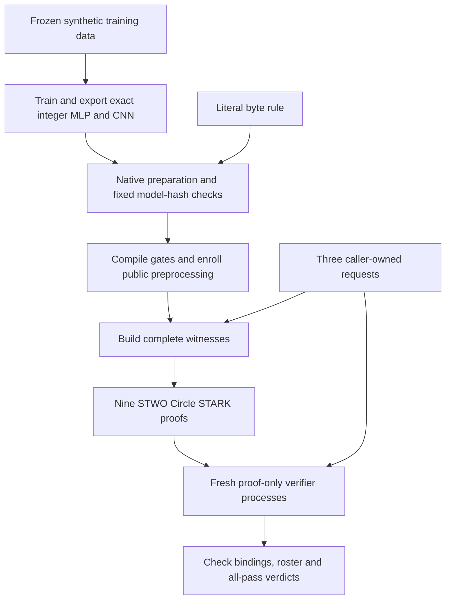

# Run the Circle STARK classifier demo

The [C1 reference](REFERENCE-RUN.md#c1-default-classifier-workflow) publishes all
nine actual proofs, every stage/per-proof time, machine details and raw logs.
Its instrumented controller takes 302.96 s; older acceptance observations below
retain their original commands and timing boundaries.

```sh
make e2e
```

The default trains the MLP and contextual byte CNN on frozen synthetic data,
exports their exact integer graphs, builds the locked STWO prover and proof-only
verifier, and proves the rule, MLP and CNN on three fixed requests. **Nine real
Circle STARK proofs** are freshly verified. No Groth16 setup runs first. No GPU,
API token, cloud account, pretrained checkpoint or hardware attestation is needed.

This command proves **classifiers only**. Use [`make e2e-llm`](LLM-PROOF.md) for
actual TinyLlama inference, or [`make e2e-composed`](COMPOSED-DEMO.md) to bind its
23 SASH proofs to three new Circle classifier proofs. See the
[architecture](ARCHITECTURE.md) and [proof statement](PROOFS.md).

## Prerequisites

| Requirement | Supported path |
|---|---|
| Host | Native Apple Silicon Mac (`Darwin`, `arm64`) |
| Tools | Git, Make, **uv 0.9.18**, Rust **nightly-2025-07-14** |
| Python | **CPython 3.12.12**, selected/acquired by uv |
| Network | Initial locked Python/Rust dependencies; no external data or inference |
| Storage | **12 GiB free** plus dependency/build caches; stop below 8 GiB during proofs |
| Memory | Up to **30 GiB sampled worker RSS**; this is a stop condition, not an OS quota |
| Time | Several minutes plus the first Rust build; the classifier controller is capped at two hours |

With an existing Rust installation:

```sh
rustup toolchain install nightly-2025-07-14 --profile minimal
git clone https://github.com/AbdelStark/hallmark.git
cd hallmark
make e2e
```

The Make target prepares the locked Python training extra. The controller trains
and screens the frozen models, checks both quantization hashes, and builds the
prover and a verifier with the prover feature disabled. It pins source/binary
bytes and independently admitted Circle enrollment before proving.

The full controller is Mac-only. Linux proof evidence is recorded separately in
the [matched benchmark](CLASSIFIER-BENCHMARK.md). `make check-conformance` is the
smaller software-only path on either platform.

## Flow and output



Progress prints a fresh `runs/e2e-circle-*` directory and named log files:

```text
Evidence: .../runs/e2e-circle-<unique-id>
Running mlp-training; log: ...
Running cnn-training; log: ...
Running circle-prove-build; log: ...
Running circle-verify-build; log: ...
Running circle-proofs
allow: generated rule proof
...
PASS: 9 Circle proofs freshly verified. Results: .../result.json
```

| Request | Rule / MLP / CNN verdicts | All-pass policy |
|---|---|---|
| `allow` | `[1, 1, 1]` | Release true |
| `cnn-block` | `[1, 1, 0]` | Release false |
| `rule-block` | `[0, 1, 1]` | Release false |

`1` means pass; `0` means block. A blocking verdict can have a valid proof.
The workflow rejects **63 changed public statements**, **18 cross-request proof
substitutions** and **three invalid rosters**, and checks native/circuit trace
parity. The frozen MLP always allows in this domain; the rule and CNN supply
block controls. These synthetic models do not establish a useful safety policy.

## Retained inputs and explicit baseline

Reuse only the exact hash-pinned quantizations from a caller-owned run:

```sh
make e2e CLASSIFIER_RUN=runs/e2e-circle-<your-run>
```

This still creates new requests, enrollment, proofs and fresh verifications.
It accepts no saved pass flag, proving key or executable from that run.

For the separate gnark/Groth16 comparison:

```sh
make e2e BACKEND=gnark
```

That legacy controller acquires pinned Go, makes circuit-specific local setups,
verifies with separate py-ecc arithmetic and runs its 405-case arithmetic corpus.
It typically needs about 20 minutes plus builds on the recorded M4 Max. Its
292-byte binary proofs and lower memory are trade-offs against Circle's larger
JSON proofs and public preprocessing. [Matched measurements](CLASSIFIER-BENCHMARK.md)
retain their original timing and security boundaries.

## Evidence, bounds and failures

| Artifact in the printed directory | Contents |
|---|---|
| `protocol.json` | Source hashes, environment, time budget; `groth16_setup: false` |
| `result.json` / `failure.json` | Complete success or failed stage and error type |
| `mlp-training/`, `cnn-training/` | Fresh training records, or admitted frozen quantizations |
| `native-preparation.json`, `native-preparation-pin.json` | Caller-owned model/request preparation, pinned before proving |
| `requests/` | Initial caller-owned synthetic controls |
| `proofs/protocol.json`, `caller-enrollment.json`, `caller-pin.json` | Exact engine/source/binary identities and pre-proof enrollment |
| `proofs/*-request.json`, `*-bundle.json` | Exact Circle-bound openings/expectations and serialized bundles |
| `proofs/result.json`, worker directories | Proof/check counts, invocation logs, resource samples and failures |

Training uses one BLAS thread. Proof workers use four Rayon threads, a shared
1,800-second proof-campaign deadline, at most 30 GiB sampled RSS and 4 GiB output.
The classifier controller reserves time for that campaign within its two-hour
budget. Sampling is not an OS quota; environments and build caches are separate.
Run one campaign at a time. New attempts use new directories and retain failures.

Failures return nonzero if a model screen/hash differs, enrollment is unexpected,
a proof/check fails, a resource boundary is reached, or tracked pipeline sources
change during execution. Inspect the printed training/build log or
`proofs/failure.json` and the failing worker's `stderr.txt`. Keep the evidence;
do not tune on test data or replace expected hashes to force a pass.

Implementation: [default controller](../scripts/run_circle_e2e.py),
[native preparation](../scripts/circle_inputs.py),
[Circle proof/check driver](../scripts/run_circle_classifiers.py),
[exact circuits and ownership](CIRCLE-CLASSIFIERS.md). Caller enrollment must come
from trusted inputs; hashes in an arbitrary prover bundle cannot authenticate it.
No hiding, independent security qualification or hardware provenance is claimed.

## Recorded default acceptance

The actual bare `make e2e` command passes with fresh training and no Groth16
bootstrap: nine proofs, 63 public-input rejections, 18 substitutions and three
invalid rosters. The complete local controller took **320.68 s** on the recorded
M4 Max with populated dependency caches. A browser-launched run reusing only the
model exports took **97.94 s**. These single acceptance observations are not the
matched performance study. [Commands, hashes and limitations](../research/evidence/circle-default-2026-10-28.json).
