# Circle STARK reference runs and proof downloads

This collection contains **23 TinyLlama proofs + three composed classifier
proofs**, plus **nine classifier control proofs**. Every proof is a real serialized
proof. The manifest lists every file’s byte count and SHA-256. CPU/GPU logs,
caller statements, enrollment, source hashes, resource samples and job receipts
are included. This is a collection of explicitly named component runs, not one
uninterrupted fresh GPU-plus-classifier run.

[Download artifacts](https://github.com/AbdelStark/hallmark/releases/tag/circle-reference-2026-10-28) · [Discussion and verification receipt](https://github.com/AbdelStark/hallmark/discussions/133) · [How to read the timings](PERFORMANCE.md)

## Runs and machines

| ID | Workload / date | Machine and execution | Included evidence |
|---|---|---|---|
| **L1** | TinyLlama SIMD/CUDA pair, 2026-10-26; `llm-gpu-oluavcvs` | HF Jobs H200 profile: 23 provider vCPUs / 256 GB RAM; one NVIDIA H200, driver 580.178.04, 143,771 MiB reported device memory; four Rayon threads; Linux x86_64 | 23 proof files + 46 statement/claim files; all per-segment stdout/stderr, commands, telemetry, build/prove/verify job logs and receipts |
| **C1** | Fresh default classifier controller, 2026-10-28; `e2e-circle-p0l734x_` | Apple M4 Max; 16 logical CPUs, 48 GiB RAM; macOS Darwin arm64; Python 3.12.12 / uv 0.9.18; four prover threads, one BLAS thread | Training/build logs, exact timing observer, nine proofs, caller requests, enrollment, all verification and rejection worker records |
| **J1** | Retained-input composition, 2026-10-28; `composed-circle-9bdff736` | Same Mac; retained TinyLlama proofs freshly checked, three new classifier proofs | Exact shared opening/model/context, classifier proofs and fresh outer-join checks; native LLM suite logs |

The H200 prover reports 3,119,974,617,088 bytes of guest-visible system memory,
which is **not the job allocation**. Its provider profile and worker limit are
recorded separately. The declared worker address-space cap is 225,485,783,040 bytes; telemetry is
sampled. L1’s CPU model and cgroup CPU quota were not captured. No exclusive physical CPU host or hardware
attestation is claimed. Exact GPU image:
`nvidia/cuda@sha256:e542739fcaa4f45da5add8c4cf5769783a61628b2518304a5bbe4ace468b8c8f`.
The separate Linux verification job uses HF `cpu-upgrade` (8 provider vCPUs /
32 GB). Raw logs preserve observed values; the provider profile is a declaration.

## L1: complete TinyLlama response

The pinned `TinyLlama-1.1B-Chat-v1.0` uses disclosed `y-attnout-w12` quantization.
It proves “The capital of France is Paris.” from the fixed France question:
eight output tokens including EOS, 22 transformer layers plus final norm/head,
23 proofs, 22 residual links and seven generated-input links.


| Measurement, all 23 segments | CPU / SIMD | GPU / CUDA | Boundary |
|---|---:|---:|---|
| Trace-generation timers | 31.84 s | 32.14 s | Host trace/witness construction reported by each segment; outside session timer |
| **Proving-session timers** | **547.75 s** | **53.94 s** | From session creation through proof generation; includes commitments and interaction work |
| ↳ Interaction timers | 60.72 s | 36.95 s | **Nested within proving session; do not add** |
| Inline verification timers | 77.62 s | 34.40 s | Internal per-segment checks after proof generation |
| **Complete segment commands** | **679.49 s** | **155.89 s** | Process wall; input/loading, generation, proving, inline verification and serialization |
| Separate full-grid CPU verifier on H200 host | 85.35 s | 84.32 s | New SIMD process, all 23 proofs and links; **not GPU verification** |
| Proof JSON bytes | 737,858,641 | 737,858,641 | Actual 23 proof files; excludes statements/claims |
| Sampled maximum host RSS | 103.75 GB | 8.07 GB | Process high-water observations, decimal GB |
| Sampled maximum GPU memory | — | 67.67 GiB | Device telemetry; not host RSS |

All 69 proof/statement/claim files are byte-identical between backends. The
matched ratios are 10.15× for the session timer and 4.36× for complete commands.
These are one CPU-then-GPU pair with shared caches, not latency distributions.
Generated constraints run on CUDA with zero constraint-evaluation fallback;
witness and interaction generation remain on CPU.

| Other L1 stage | Measured duration / status | What it includes |
|---|---:|---|
| Checkpoint download, quantization and full witness extraction | **Reused; not timed in L1** | Original preparation has its own identity; this is not a fresh preparation result |
| Original generated-kernel build job | 1815.94 s | Separate earlier **CPU build job’s running interval**, not isolated compilation; 77 generated shapes |
| Model-root command | 113.86 s | Separate command on the measurement host, before segment runs |
| Fresh Linux CPU proof-only checks | 77.40 / 77.61 s | Per honest full-bundle check on the separate 8-vCPU / 32-GB worker; runtime shape preprocessing |
| Native Mac proof-only checks | 3.40 / 3.53 s | Per honest full-bundle check **after compilation**, with caller-enrolled shape roots compiled in |
| Native Mac build + complete suite | 314.84 s | Separate L1 postflight; build, two honest checks and all 36 rejection cases |
| Complete cached-build benchmark controller | 2,086.78 s | SIMD and CUDA runs, fixtures, transport, root/grid checks and CPU/Mac suites |
| Isolated input parsing / serialization / transfer totals | **Not separately recorded** | Included in enclosing command/controller walls; no zero-cost claim |




Do not add these rows: some are nested and others belong to separate jobs or
postflights. Lower-level FRI, Merkle and constraint timers are retained in each segment’s
`result.point.phases` and in the numeric receipt. These profiler timers overlap;
they are not an additive wall-time decomposition.

Native and Linux verifiers share SASH’s crypto implementation but
have different public preprocessing; their times are not a matched speedup.
Both require independently admitted model/shape/calibration roots and token case.
[Exact statement](LLM-PROOF.md#the-statement), [GPU method](GPU-BENCHMARK.md).

## C1: default classifier workflow

C1 freshly trains and exports the frozen models, builds the locked prover and
proof-only verifier, then generates and verifies all nine control proofs.
Dependency caches are populated; the Rust target directory starts empty. This
is **one local reference observation**, not the repeated HF benchmark.



| Outer stage | Wall time | Boundary |
|---|---:|---|
| MLP training/export | 1.95 s | Complete child command |
| CNN training/export/screen | 172.94 s | Complete child command, frozen study v2 |
| Rust prover build | 24.82 s | Complete locked Cargo command |
| Rust proof-only verifier build | 9.57 s | Complete locked Cargo command |
| Proof campaign | 93.50 s | Enrollment, native witnesses, nine proofs/checks, negatives and caller checks |
| **Complete observed controller** | **302.96 s** | All stages above and host work; **uv environment bootstrap is outside this timer** |

| Within the proof campaign, all nine proofs | Seconds / bytes | Boundary |
|---|---:|---|
| Enrollment commands | 3.881 s | Three fresh public preprocessing enrollments |
| Host witness construction | 15.613 s | Graph construction, trace parity and witness encoding |
| Prover input parsing | 2.216 s | **Inside** complete prover commands |
| Preprocessing / model commitment | 7.882 s | **Inside** complete prover commands; repeated per proof |
| Admission, twiddles and transcript | 0.172 s | Inside prover command |
| Base trace generation | 0.035 s | Inside prover command |
| Base trace commitment | 6.109 s | Inside prover command |
| Interaction generation | 0.392 s | Inside prover command |
| Interaction commitment | 7.782 s | Inside prover command |
| **Final STWO proving call** | **24.061 s** | Excludes preceding trace/commitment work; **different boundary from SASH `prove_secs`** |
| Serialization/write | 0.033 s | Inside prover command |
| **Complete prover commands** | **50.028 s** | Fresh process wall, including parsing, engine work and serialization |
| **Fresh proof-only verifier commands** | **0.807 s** | Nine fresh processes; excludes host public-input reconstruction/native reruns |
| 63 changed-public-input verifier commands | 3.089 s | Cryptographic rejection processes |
| **Actual serialized proof files** | **18,063,779 bytes** | All nine canonical JSON proofs; not the hex bundles or complete evidence archive |
| Maximum sampled worker-tree RSS | 23.45 GB | Maximum across campaign workers; not a sum of peaks |

Public statement reconstruction, native reruns, host program construction,
18 cross-request checks, three roster checks and controller bookkeeping remain
inside the 93.50 s campaign; they were not individually timed. Internal stage
rows are nested inside the 50.03 s prover total; do not add both levels.
An all-pass verdict is separate from proof validity. The frozen MLP always
allows at this input limit; the CNN blocks the ordinary LLM prompt.

### Each C1 proof

The raw artifact kind `encoder` denotes the contextual byte CNN.

| Request / classifier | Host witness, s | Final STWO prove, s | Prover process, s | Proof-only verifier process, s | JSON proof bytes |
|---|---:|---:|---:|---:|---:|
| allow / rule | 0.976 | 1.849 | 3.900 | 0.345 | 1,935,860 |
| allow / mlp | 1.117 | 1.834 | 3.926 | 0.052 | 1,982,968 |
| allow / encoder | 3.105 | 5.145 | 9.751 | 0.053 | 2,103,162 |
| cnn-block / rule | 0.974 | 1.805 | 3.882 | 0.078 | 1,934,915 |
| cnn-block / mlp | 1.124 | 1.810 | 3.925 | 0.050 | 1,939,884 |
| cnn-block / encoder | 3.100 | 3.970 | 8.365 | 0.053 | 2,152,325 |
| rule-block / rule | 0.971 | 1.846 | 3.981 | 0.075 | 1,956,696 |
| rule-block / mlp | 1.153 | 1.836 | 3.938 | 0.050 | 1,948,783 |
| rule-block / encoder | 3.092 | 3.967 | 8.359 | 0.051 | 2,109,186 |

The repeated [HF CPU comparison](CLASSIFIER-BENCHMARK.md) is a separate experiment:
eight workflows per backend on AMD EPYC 7R13 / `cpu-upgrade`, with different
per-process costs and no training inside its sample timer. Its 298.88 s warm
Circle median must not be mixed with C1’s Mac stage observations.

## J1: same-request composition

The retained-input default command takes **266.29 s**. Its native LLM workflow
is 216.87 s, including a **115.53 s build**, two fresh honest checks and all 36
LLM mutation cases. The classifier controller is **44.12 s**; it generates three
new Circle proofs and runs binding checks. Three outer-join proof checks and
host hashing/binding complete the enclosing workflow. The nested stages and
root times are retained; no sum is presented as a fresh GPU end-to-end latency.
The three classifier proofs total **6,020,695 bytes**; their complete prover
commands total **18.854 s**, final STWO proving timers **9.083 s**,
and inner proof-only verifier processes **0.421 s**. The outer join verifies
those proofs again in 0.167 s of fresh verifier processes,
and rejects all 16 changed bindings/rosters.

All 23 LLM proofs and 22 links verify freshly. Verdicts `[1,1,0]` give **integrity
pass / policy release false**. The LLM proof bytes equal L1’s published files;
the composition uses the exact fixed prompt, response and model. The classifiers
inspect the prompt; the response is bound into context, not classified. This
is host composition, with no recursive proof, hiding or hardware claim.

## Download and verify

The artifact release is a **research proof collection**, not a qualified
software release. Its tag identifies the repository baseline before this
reference-documentation change; it is not every component’s measured commit. Use a checkout
containing this guide and `scripts/verify_reference.py`; the Discussion pins the
verification utility’s publication commit. No weights, witnesses, trusted remote
executable or HF credential are needed. Native verification requires the
[Mac/Rust prerequisites](LLM-PROOF.md#verify-retained-proofs-on-your-mac), uv 0.9.18,
Python 3.12.12, the train extra for classifier public-input reconstruction,
and **12 GiB free** plus build caches.

```sh
mkdir -p runs/reference-download
cd runs/reference-download
curl -fL -O https://github.com/AbdelStark/hallmark/releases/download/circle-reference-2026-10-28/reference-manifest.json
curl -fL -O https://github.com/AbdelStark/hallmark/releases/download/circle-reference-2026-10-28/SHA256SUMS
curl -fL -O https://github.com/AbdelStark/hallmark/releases/download/circle-reference-2026-10-28/llm-proofs.tar.gz
curl -fL -O https://github.com/AbdelStark/hallmark/releases/download/circle-reference-2026-10-28/reference-records.tar.gz
shasum -a 256 -c SHA256SUMS
cd ../..
uv run --locked --python 3.12.12 --extra train --extra llm \
  python scripts/verify_reference.py \
  --directory runs/reference-download \
  --expected-manifest 2ea625c25d8305d6f006f6b492cffb066e93b5d7e8d92d7da6269156c5c1e6e8
```

Obtain the manifest digest from this guide or the Discussion through a trusted
channel. A checksum delivered only by an untrusted prover is not enrollment.
The command first checks the externally pinned manifest, exact archive rosters
and every member hash. It rebuilds the source-pinned native verifier, checks the
LLM bundle twice with all 36 mutation cases, rebuilds the proof-only STWO
verifier and freshly checks all **12 classifier proofs**, reconstructing their
expected public inputs. The composed request is checked against the fixed LLM
case. A hash-only success cannot produce the cryptographic success result.

Expected final counts: **23 distinct LLM proofs**, **two complete honest LLM
checks**, **nine classifier controls + three composed classifier proofs**.
Failures return nonzero and preserve generated logs. The helper launches no
cloud job and downloads no model. Initial pinned Rust/SASH dependencies may need
network access; the proof workers themselves are sandboxed without networking.

Recompute the published numbers from the extracted raw records:

```sh
uv run --locked python scripts/reference_report.py \
  --records runs/reference-verify-<your-run>/records \
  --output runs/recomputed-reference-metrics.json
```

## Source identities by component

The manifest’s `source_commit` is the **repository baseline for packaging this
collection**, not a statement that every historical component ran at that commit.

| Component | Captured source |
|---|---|
| L1 measurement controller | Hallmark `ef09216eabee044c24209f555df39e277ee6dfaa` |
| L1 generated-kernel build controller | Hallmark `74bc2db33df5cf4d1e5a5b101b30fecba122960f` |
| L1 underlying SASH source | `eb95bfa887299d1637550228d42086c27cbb2b3b`; unchanged SIMD, inventoried generated CUDA patch |
| C1 default controller | Repository baseline `9bea024dc7d4604f17d53c915b64bc4a23c408b5`, with the new timing observer captured byte for byte before execution; `timing/protocol.json` pins every tracked pipeline file |
| J1 Circle-default composition | Pre-merge baseline `f613c611cefa9037320082b73777f26c9ec45990` plus the archived per-file source snapshot in `composition/protocol.json`; these are the default changes later merged as `9bea024` |
| Public verification utility | Hallmark `5fe56cdb459366850e83162769f8373451131b7d`; crypto source identities are checked independently of the documentation commit |

Binary hashes, patches, model revisions, graph/preprocessing roots and concrete
parameters are retained with their own runs. Per-file snapshots identify local
changes; a bare commit label alone would not reproduce an uncommitted observer
or pre-merge controller. None of the historical measurement files is rewritten.

## Concrete proof parameters

| Parameter | SASH LLM | Direct-STWO classifiers |
|---|---:|---:|
| FRI queries | 100 | 80 |
| Log blowup factor | 1 | 4 |
| Last-layer log degree bound | 0 | 5 |
| Proof-of-work bits | 0 | 16 |
| Fold step | 1 | 1 |

Both use Blake2s-based Merkle transcripts, but these are different relations,
implementations and concrete configurations. SASH reports a conjectured 100-bit
value; this is not independent security qualification. No equal-security speed
comparison follows. Each classifier enrollment also pins graph size, program
hash, preprocessing root and public-wire multiplicities.

## Files, provenance and omissions

| Asset | Bytes | Contents |
|---|---:|---|
| [LLM proof archive](https://github.com/AbdelStark/hallmark/releases/download/circle-reference-2026-10-28/llm-proofs.tar.gz) | 355,320,899 | Original accepted CUDA gzip bytes; 23 proof JSONs + 46 fixed/claim JSONs |
| [Reference records](https://github.com/AbdelStark/hallmark/releases/download/circle-reference-2026-10-28/reference-records.tar.gz) | 93,363,516 | 988 exact files: classifier proofs/statements/enrollment, logs, resource/cost records, machine/job metadata, timing observer and original numeric evidence |
| [Manifest](https://github.com/AbdelStark/hallmark/releases/download/circle-reference-2026-10-28/reference-manifest.json) | 522,298 | Archive/member byte counts, SHA-256, original source paths, source/backend identities and independent classifier enrollment |
| [Checksums](https://github.com/AbdelStark/hallmark/releases/download/circle-reference-2026-10-28/SHA256SUMS) | 265 | Digests for the three assets above; manifest’s external pin remains authoritative |

Manifest SHA-256:
`2ea625c25d8305d6f006f6b492cffb066e93b5d7e8d92d7da6269156c5c1e6e8`.
The actual proof files and the transport archives have different sizes. The
classifier bundles contain hex-encoded JSON proof bytes; they are not compact
binary proofs. Rejection directories retain repeated copies of honest proofs
with changed public statements, so archive bytes are not a unique-proof sum.
The collection excludes credentials, private material, model checkpoints,
witness archives, compiled executables and caches. Selected raw logs are copied
without transformation; the manifest pins their original bytes. Source and
model revisions, licences and enrollment must be checked separately from hashes.

The LLM uses pinned upstream SASH source
`eb95bfa887299d1637550228d42086c27cbb2b3b`; SIMD is unchanged, CUDA has the
recorded generated-kernel patch. The native LLM verifier identity is
`8567c911d686b13b09032b75e1fc041e6bbcc9407cb2755b60746112102b342a`.
The classifier backend/compiler identity is
`c035913b3196640797273bb0c22c2e69b09dee2a790d128be51287a6351ded7d`.
All weight/threshold/data identities remain frozen. The proof parameters differ
between SASH and direct STWO; this collection claims no equal-security ranking,
independent security review, production policy quality or hardware provenance.


The [repository receipt](../research/evidence/circle-reference-2026-10-28.json)
contains recomputed metrics, anonymous-download hashes, the fresh cryptographic
acceptance and the retained initial quota failure. The proof-verification utility
is pinned at commit `5fe56cdb459366850e83162769f8373451131b7d`. The exact executed
timing observer is retained as `timing/recorder-used.py`; its source hash matches
the pre-run protocol. The maintained observer only removes its unused import.
