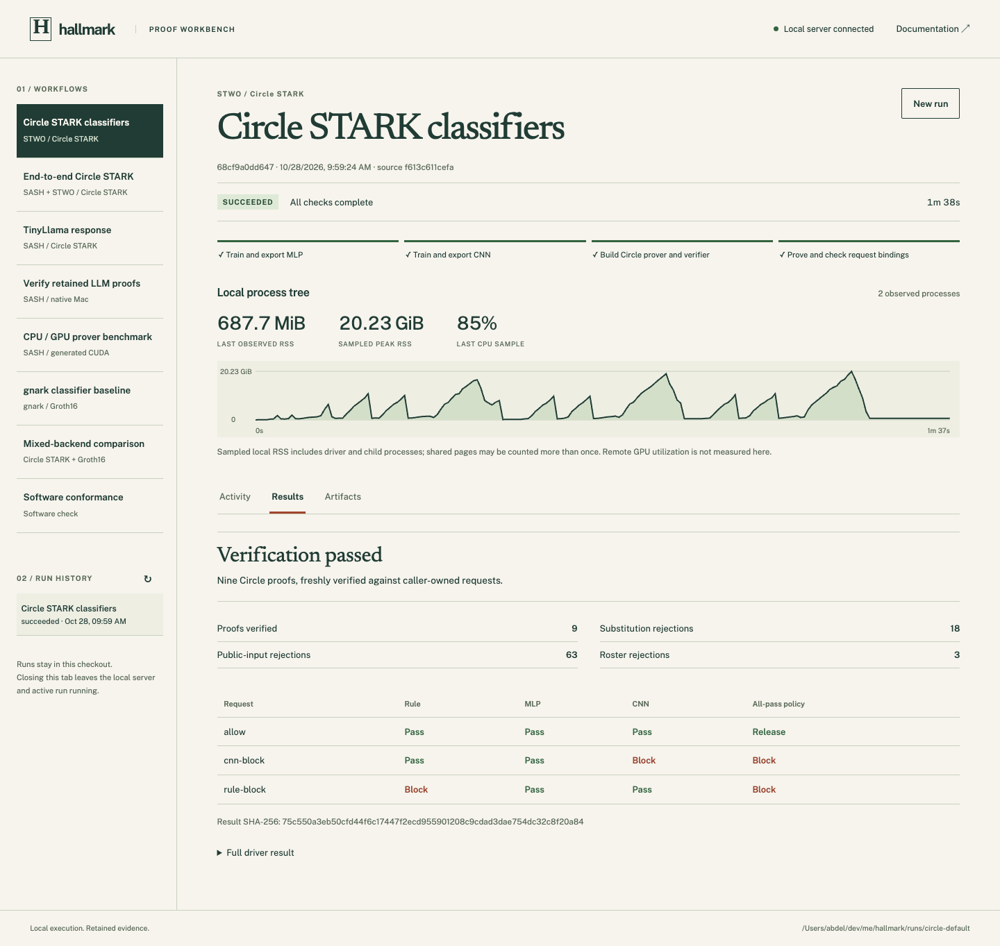
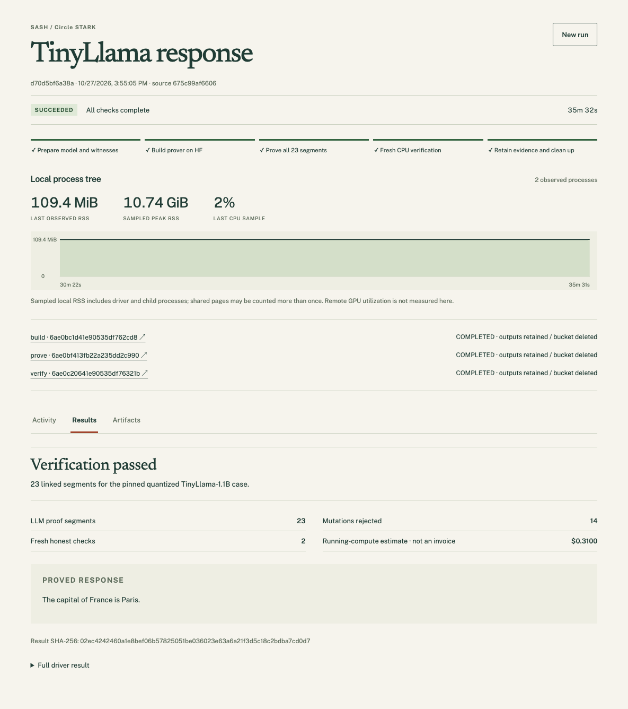
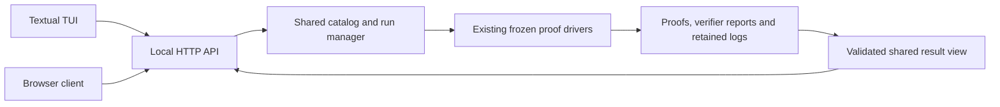

# Terminal and web workbench

Both interfaces run Circle STARK proof workflows. The
[current Circle acceptance](../research/evidence/circle-default-2026-10-28.json)
records a real browser-launched nine-proof run and default-selection checks.
Both interfaces have passed real proof-workflow acceptance. The earlier
[QA record](../research/evidence/demo-workbench-2026-10-27.json) pins the inputs,
result hashes and checks; [decision 0082](decisions/0082-demo-workbench.md)
records the implementation boundary.

The workbench launches the same drivers as `make e2e`, `make e2e-llm` and the
other documented workflows. It adds a shared run history, observed stage
progress, local resource charts, logs, results and artifact downloads.



An earlier fresh TinyLlama run shows the separate LLM workflow:



The terminal reads the same controller.

## Start an interface

From a source checkout, using uv:

```sh
make demo-web
make demo-tui
```

The app environment is separately locked under `apps/`. It supplies the frozen
uv 0.9.18 required by proof workflows. Python 3.12–3.14 can run the app; proof
commands explicitly select 3.12.12. First launch installs the app dependencies;
proof/training dependencies are prepared by their existing drivers.

The web app opens `http://127.0.0.1:8765`. Both commands use the same local
controller when it is already running for this checkout. The TUI's **W** key
opens the web view of that controller. To choose a port or checkout:

```sh
uv run --locked --project apps --no-dev hallmark-demo web --port 8766 --no-browser
uv run --locked --project apps --no-dev hallmark-demo tui --root /path/to/hallmark
```

Only loopback is supported. This is a local research workbench, not a public
multi-user job service.

## Workflows

| Workflow | Execution and result |
|---|---|
| Circle STARK classifiers | Fresh training/export or pinned model reuse; nine direct-STWO proofs with fresh proof-only verification and rejection checks; Apple Silicon Mac |
| End-to-end Circle STARK | 23 freshly verified SASH LLM proofs plus three new STWO classifier proofs for the same request |
| TinyLlama response | Fixed quantized model/prompt; 23 SASH segments and fresh checks; bounded paid HF CPU jobs |
| Verify retained LLM proofs | Rebuild caller-enrolled native verifier and check an existing bundle; local Mac, no paid job |
| CPU/GPU prover benchmark | Matched SIMD/CUDA execution on one H200; retained admitted preparation, live prepaid balance and capped paid jobs |
| Software conformance | Small software check; generates no cryptographic proof |

The fixed LLM prompt and quantized model are shown before launch. Arbitrary
prompts/models need a new admitted proving relation; the app cannot turn them
into the existing case. Retained-input fields accept paths under this checkout's
`runs/`, with suggestions from completed runs. The proof drivers recheck inputs.

Paid runs read `HF_TOKEN` on the server from its environment or ignored `.env`.
The browser never asks for or receives the token. Cost caps, price checks,
active-job guards, balance checks and cleanup remain in the existing drivers.
The app's startup-inclusive ceilings are $2.50 for a fresh LLM/composed run
and $5 for the GPU benchmark. They differ from the original CLI's $2.10
worker-timeout-only LLM estimate: the app reserves another 600 seconds of
provider creation/cancellation time per phase. `resource-plan.json` records the
live rates and bound before work starts. The GPU balance field requires a freshly
checked prepaid balance. No app retry
starts another cloud job automatically.

## Read a run

Select a workflow, inspect its statement and prerequisites, then start it.
Only one run executes at a time. Select a retained run in the history to inspect
its logs, verification outcome and admitted JSON reports.

- Stages advance from driver output. They are not time estimates or proof counts.
- Memory and CPU are sampled from the **local process tree**. RSS can count
  shared pages more than once. Remote GPU utilization is not inferred from them.
- HF job links and status connect remote work to its retained records.
- A successful proof verification can contain a classifier **block** verdict.
  The all-pass policy decision is displayed separately.
- A receipt export is monitoring JSON. It is not a cryptographic aggregate proof
  or an authenticated enrollment authority.

Full proofs, keys, checkpoints and exact driver logs stay in the run directory.
The UI streams redacted output and offers an explicit set of JSON reports;
it cannot serve arbitrary files from the checkout. Raw local driver logs are
private to the local user and are not published by the app.

## Terminal controls

| Key | Action |
|---|---|
| Arrow keys, Enter | Choose a workflow or history entry |
| Tab / Shift-Tab | Move between controls and detail tabs |
| R | Start the selected workflow |
| S | Request active-run cancellation |
| N | Prepare a new run |
| W | Open this controller in the browser |
| E | Export the selected run's monitoring receipt |
| Q | Quit; an owning TUI asks before stopping an active run |

## Stop, reconnect and recover

Closing a browser tab leaves its server and run active. Reload or open the TUI
to inspect the same run. Stopping the server requests driver cleanup and retains
its state under `runs/workbench/`.

Recovery checks the recorded PID **and process creation time**. It observes a
live driver rather than relaunching it. A missing process without a successful
result is interrupted, not a completed proof. A result's schema, counts and
policy consistency must pass its adapter before the app shows verification
success. Unconfirmed cloud cleanup is shown as **needs attention**, with the
retained job/bucket records available for inspection.

Temporary sampling/read failures keep observing the same process. They do not
cancel or retry paid work. If you update the app source, restart its controller
after the active run finishes; new launches require one consistent app revision.
The storage marker in `runs/workbench/` identifies app-owned metadata. An
unrecognized nonempty directory is refused rather than overwritten.

## Architecture and extension



| File | Responsibility |
|---|---|
| `apps/hallmark_demo/catalog.py` | Workflow statements, prerequisites, stage markers and command arrays |
| `apps/hallmark_demo/engine.py` | One-run lifecycle, persistence, process observation, cancellation, redaction and admitted artifacts |
| `apps/hallmark_demo/results.py` | Per-driver completion contracts and the result view used by both clients |
| `apps/hallmark_demo/execute.py` | Startup-inclusive paid-job admission, followed by the unchanged proof driver |
| `apps/hallmark_demo/server.py` | Loopback transport, Host/Origin/session-token checks and static assets |
| `apps/hallmark_demo/tui.py` | Terminal layout, keyboard actions and rendering |
| `apps/hallmark_demo/web/` | Browser layout, rendering and local interaction |

To add a proving approach, implement and validate its driver first. Register a
workflow with its explicit statement, cost/resource bounds, stage markers and
allowed fields. Add its argument-array adapter and result contract. Both clients
consume that shared definition and result view; do not copy proving code into
either interface or accept arbitrary shell commands from a client.

The controller validates a driver's completion report; cryptographic checks
remain in the original verifier drivers. A green UI result is not another
independently implemented verifier.

Changing an inference relation or evaluator still requires the research decision
and conformance process. App wiring cannot qualify a new proof backend, hardware
attestation or witness privacy.

## Development checks

The 2026-10-27 acceptance used the frozen published drivers:

| Interface and workflow | Observed result |
|---|---|
| Web: retained LLM verification | 23 proofs; 2 honest checks; 36 mutations rejected |
| Web: fresh TinyLlama proving | 23 proofs; 22 residual links; 2 honest checks; 14 mutations rejected |

The fresh LLM workflow took 35 min 32 s including preparation, builds, transfers,
proving, verification and cleanup. Its recorded running-compute estimate is
$0.31, not an invoice; admission reserved a $2.50 ceiling. All three HF jobs
completed and their buckets were deleted. These are app acceptance observations,
not a new performance benchmark. GPU and composed adapters have regression
coverage and retained-result checks; those complete workflows were not rerun for
this app acceptance. The composed driver still requires 32 GiB free storage.

```sh
make check-demo
make check
make package-check
make docs
```

App tests exercise real small subprocesses and both interfaces. Their fixture
reports have no cryptographic claim. Browser QA uses an isolated Chrome instance;
it never loads a personal browser profile. Real proof acceptance is recorded
separately with its raw artifacts, source hashes and exact run commands.
