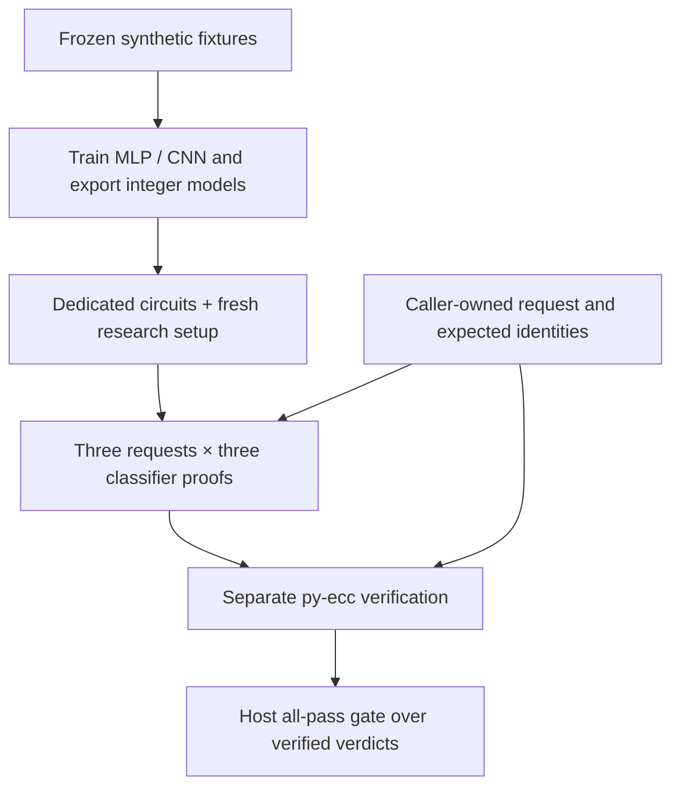

# Verify one request

The local classifier workflow is the smallest complete proof demo. It trains
an MLP and a contextual byte CNN, exports exact integer graphs, and checks three
classifiers over each of three synthetic requests.

```sh
make e2e
```

This command requires the [Mac demo prerequisites](../DEMO.md#prerequisites).
For a small software-only check on Linux/macOS, follow
[the workflow chooser](../START.md); that check generates no proof.

## Follow the evidence



The caller reconstructs public inputs from its expected request. It checks that
the proofs use the enrolled classifier/program/circuit/key before interpreting
the verdicts. A model downloaded from Hugging Face is useful for native
inference, but does not perform these proof or enrollment checks.

## Three controls, different reasons to block

| Case | Rule | MLP | CNN | All-pass gate |
|---|---|---|---|---|
| Benign active action, restricted action quoted | Pass | Pass | Pass | Pass |
| Restricted active action, benign action quoted | Pass | Pass | Block | Block |
| Benign case prefixed with `BAD; ` | Block | Pass | Pass | Block |

The contextual pair has the same byte counts. The MLP cannot distinguish it;
the CNN can use local order. The literal rule detects its fixed marker,
including across chunk boundaries.

These controls test the artificial grammar and proof plumbing. They do not
establish a useful real-world safety policy.

## What to inspect after the command

The driver prints a fresh local `runs/e2e-…` path. Read its
[documented output layout](../DEMO.md#evidence-and-resource-bounds):

- training records and original/resumed checkpoints;
- quantizations and integer model identities;
- fresh circuit/setup keys and proof files;
- independent arithmetic-verifier results;
- cross-request substitution and arithmetic checks.

The retained model exports are also available as
[public model releases](../MODELS.md). Their pinned revisions and manifests
let you inspect the weights without rerunning training.

## Now join the LLM

```sh
make e2e-composed
```

A fresh run also launches the paid LLM workflow; read its
[prerequisites and cost ceiling](../COMPOSED-DEMO.md#run-the-workflow) first.
Caller-owned retained inputs can avoid new cloud jobs.

The composition joins the proved TinyLlama request to three new classifier
proofs. The classifiers inspect its prompt only. The ordinary LLM prompt is
blocked by the frozen CNN, while its computation proof still verifies.

That result is useful: it makes the difference between **correct computation**
and **good policy** visible.

## Next steps

[Run the full classifier guide](../DEMO.md) ·
[Prove the pretrained response](../LLM-PROOF.md) ·
[Audit the research evidence](../research/index.md) ·
[Contribute a matched backend comparison](https://github.com/AbdelStark/hallmark/issues/112)
