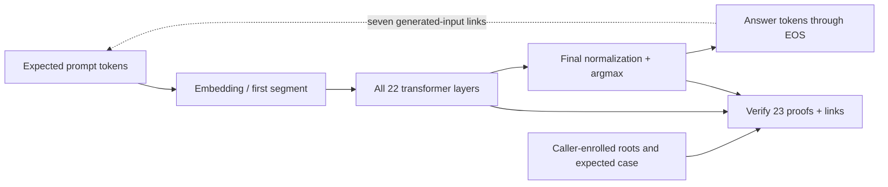

---
hide:
  - toc
---

# Read a proof statement

Select the LLM proof, a classifier proof or their composition to see the
computation, the caller's expected inputs, and the checks performed.

<button type="button" data-proof-choice="llm" aria-pressed="true">LLM response</button>
<button type="button" data-proof-choice="classifier" aria-pressed="false">Classifier verdict</button>
<button type="button" data-proof-choice="composition" aria-pressed="false">Composition</button>

<section class="hm-proof-panel" data-proof-panel="llm" markdown="1">

### A complete short LLM response

**Computation:** the enrolled quantized TinyLlama model greedily computes all
eight answer tokens, including EOS, from the expected prompt tokens.

**Caller expectations:** model, shape and calibration roots and the exact
prompt/output token case. Tokenization and detokenization are pinned host checks.

**Cryptographic checks:** all 23 SASH segments, 22 residual links, the output
argmax and seven generated-input/previous-output equalities in one 32-position
input block.

**Outside the claim:** equivalence to unmodified floating-point Transformers
inference, authentic input capture, hardware provenance and witness hiding.

[Exact LLM statement](../LLM-PROOF.md#the-statement)

</section>
<section class="hm-proof-panel" data-proof-panel="classifier" markdown="1">

### An exact classifier verdict

**Computation:** a fixed rule, MLP or CNN computes its verdict over the complete
admitted prompt bytes. Hashing, coverage, integer arithmetic and threshold
comparison belong to the relation.

**Caller expectations:** exact request context, classifier/program identity,
program, preprocessing roots and concrete proof parameters. The caller reconstructs expected public inputs.

**Cryptographic checks:** dedicated Circle STARK proofs checked by fresh
proof-only STWO processes against those inputs and the enrolled preprocessing.
The optional gnark comparison uses separate py-ecc pairing arithmetic.

**Outside the claim:** training history, a useful safety policy or a confidential
input capture mechanism. The combined demo limit is 96 UTF-8 bytes.

[Classifier public fields and caller checks](../PROOFS.md)

</section>
<section class="hm-proof-panel" data-proof-panel="composition" markdown="1">

### Two relations, one opened request

**Computation:** freshly verify the LLM bundle, then bind three classifier
proofs to that same prompt/response context.

**Caller expectations:** the same opened request and independently admitted
LLM/classifier identities. The classifiers inspect the prompt only; the response
is bound into their context, not classified.

**Composition checks:** request equality and verified classifier verdicts joined
with `all-pass` in host code.

**Outside the claim:** recursive aggregation or a proof of the host composition
program itself. A valid joined result may contain a classifier block.

[Exact composed join](../COMPOSED-DEMO.md)

</section>

## Why 23 segments?

TinyLlama has 22 transformer layers in this case. The final normalization and
output head form the remaining segment. The verifier checks each proof and
connects its inputs and outputs to the expected model and token sequence.

The verifier checks a bundle of 23 proofs separately. All tokens fit in one
block, so there are zero inter-block token links and seven within-block
autoregressive checks.

## Caller checks {#why-caller-checks-matter}

The caller must choose the model and request it expects, then reconstruct the
public inputs. If it accepts identities supplied only by the prover, a valid
proof for a different model or request could pass.

The native Mac verifier uses compiled, caller-enrolled shape roots; the Linux
path derives them at runtime. Their timings include different preprocessing
and rely on different enrollment steps, so they cannot establish a backend
speedup.

## A verifier's checklist

1. Establish the expected model, parameters, request and accepted proof system.
2. Reject incomplete bundles, changed identities or unsupported modes.
3. Check every cryptographic proof.
4. Check segment/token links and common-request binding.
5. Interpret the verified classifier verdict separately from proof validity.

[Architecture and source ownership](../ARCHITECTURE.md) trace these checks to
the actual adapters. Continue with [two proof systems](proof-systems.md).
