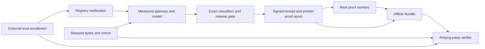

# Architecture

## Current modules

`contracts.py` validates input models; `integrity.py` owns bounded I/O and research hashes; `data.py` checks IDs and cross-split groups/transcripts; `reference.py` executes the integer floor; `training.py` performs optional float64 fitting/PTQ; `evaluation.py` calibrates and counts; `experiment.py` writes/replays bundles; `cli.py` exposes local commands. No network service or security verifier exists. `load_records` checks uniqueness/leakage; `admit` additionally requires all splits, data identity and configured source/licence allowlists. Those allowlists are declarations, not approval.

## Target boundaries

| Boundary | Responsibility | Inputs → outputs | RFC |
|---|---|---|---|
| `wire` | Strict versioned codecs, commitments and envelopes | bytes → admitted immutable types | [0001](../rfcs/RFC-0001-wire.md) |
| `registry` | Signed snapshots, history, enrollment, retirement | trusted roots + snapshot → enrolled artifacts | [0002](../rfcs/RFC-0002-registry.md) |
| `classifiers` | Exact byte/token transforms and integer graph execution | admitted manifest + text → ordered chunk scores | [0003](../rfcs/RFC-0003-integer.md) |
| `research` | Approved lineage, fitting, calibration and held-out reporting | frozen protocol + data → candidate/evidence | [0004](../rfcs/RFC-0004-ml.md) |
| `proofs` | Bounded real backend adapters | enrolled program + witness → proof/result | [0005](../rfcs/RFC-0005-proofs.md) |
| `attestation` / `gateway` | Measured loading, genuine evidence and release control | admitted request → signed receipt + gated output | [0006](../rfcs/RFC-0006-hardware.md) |
| `receipts` / `verification` | Lifecycle, composition and typed claims | complete bundle + external trust → result | [0007](../rfcs/RFC-0007-verifier.md) |
| `diagnostics` | Stable errors, redacted events and costs | stages → bounded local metadata | [0008](../rfcs/RFC-0008-operations.md) |
| conformance / independent verifier | Cross-implementation checking | published vectors + genuine artifacts → agreement report | [0009](../rfcs/RFC-0009-conformance.md) |
| packaging / documentation | Private reproducible release and maintenance | reviewed source + evidence → review packet | [0010](../rfcs/RFC-0010-release.md) |

Names specify ownership, not a demand for empty packages. Extend existing modules where the interface remains clear. Keep core verification free of training runtimes. Heavy integrations are optional extras and run in separate processes with explicit budgets.

## Data flow

External enrollment fixes the trusted identities before a request. The measured gateway binds the actual model execution and complete classifier inputs, signs the receipt, and stores the private witness for proofs. The assembler collects genuine proofs and hardware collateral. The verifier takes its trust policy and request expectation from outside the bundle and checks the bundle without fetching URLs.

**INV-ONE-WRITER:** one process owns each receipt's state transition; workers use exclusive job claims. Publishing a completed bundle uses a same-filesystem atomic rename after durable writes. Retries never allocate a new receipt for the same nonce or change the signed body.

**INV-FAIL-CLOSED:** unavailable keys, collateral, storage, classifier execution or policy never releases a response. Proof failure after release yields an unverified receipt; it does not retroactively make the response verified.

Only the gateway holds epoch signing keys. The spool is encrypted with per-receipt keys sealed to the authorized host, inaccessible to the untrusted operator under the declared hardware assumptions. The offline verifier opens only caller-supplied regular files; it follows no archive paths or embedded URIs.
